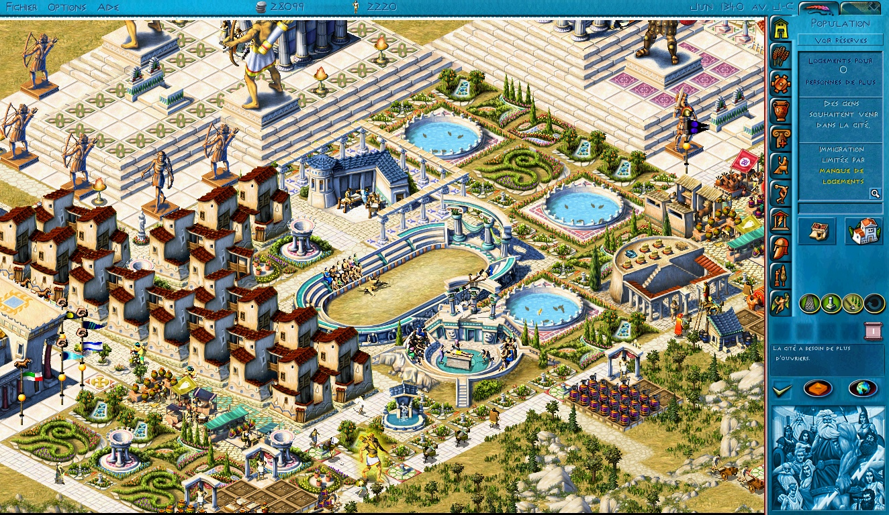
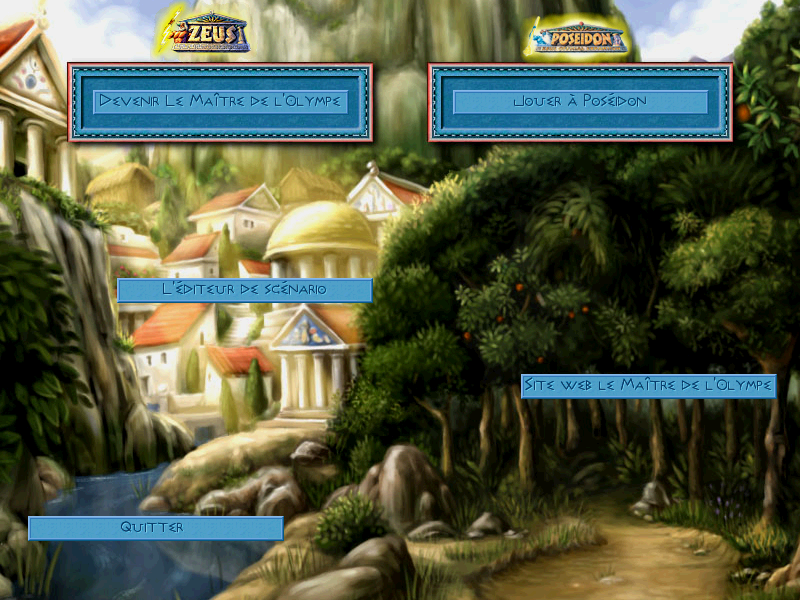
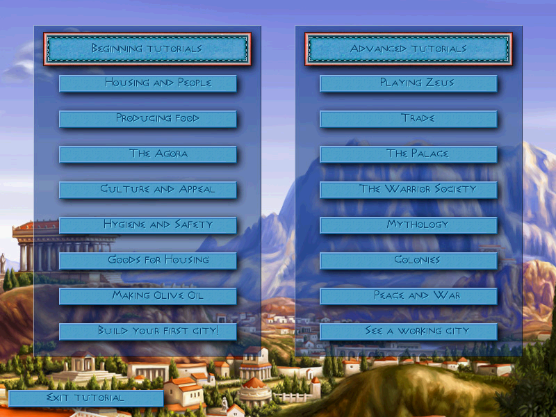

# Zeus + Poséidon sur Mac et Linux

[](https://github.com/nic0lasm/zeus-poseidon-arm64/releases/latest)
[](#télécharger)
[](#télécharger)
[](https://github.com/nic0lasm/zeus-poseidon-arm64/actions/workflows/build.yml)
[](docs/equivalence.md)
[](LICENSE)

**Jouer à *Zeus : Le Maître de l'Olympe* et à son extension *Poséidon* sur un Mac (Apple
Silicon ou Intel) ou sous Linux : le jeu d'origine, sans Windows, sans Wine et sans machine virtuelle.**

*[English version](README.md)*

<p align="center">
  
</p>
<p align="center">
  
  
</p>
<p align="center"><sub>Une grande ville en mode large, et le menu principal en français, à partir de votre propre exemplaire du jeu.</sub></p>

## En un coup d'œil

| | |
|---|---|
| **Ce que c'est** | Le vrai *Zeus* + *Poséidon* (Impressions Games, 2000) : le code d'origine du jeu, non modifié, exécuté dans un petit émulateur x86. Même simulation, mêmes règles, mêmes sauvegardes. Pas une réécriture. |
| **État** | Jouable du début à la fin. Dernière version : **[1.7.2](https://github.com/nic0lasm/zeus-poseidon-arm64/releases/latest)** (10 novembre 2026). |
| **Fonctionne sur** | Mac Apple Silicon ou Intel, macOS 11 (Big Sur) ou plus récent ; Linux x86-64 et arm64. |
| **Il vous faut** | Votre propre copie du jeu, édition GOG (ou [Steam](#acheté-sur-steam-)). Ce dépôt ne contient aucun fichier du jeu ([Mentions légales](#mentions-légales)). |
| **Fidèle** | Dix scénarios rejoués comparent chaque image et tout l'état de la partie, tour par tour, avec le jeu d'origine. |
| **Léger** | Une petite ville occupe environ 23 % d'un cœur (51 à 60 % en 1.0.1). [Chiffres](#principe). |

## Télécharger

| Votre ordinateur | Téléchargement |
|---|---|
| Mac à puce Apple Silicon (M1 ou plus récent), macOS 11+ | **[⬇ Zeus-Poseidon-macos-arm64.zip](https://github.com/nic0lasm/zeus-poseidon-arm64/releases/latest/download/Zeus-Poseidon-macos-arm64.zip)** |
| Mac à processeur Intel, macOS 11+ | **[⬇ Zeus-Poseidon-macos-intel.zip](https://github.com/nic0lasm/zeus-poseidon-arm64/releases/latest/download/Zeus-Poseidon-macos-intel.zip)** |
| Linux x86-64 (Ubuntu 22.04, Debian 12, Fedora 36 ou plus récents) | **[⬇ Zeus-Poseidon-linux-x86_64.AppImage](https://github.com/nic0lasm/zeus-poseidon-arm64/releases/latest/download/Zeus-Poseidon-linux-x86_64.AppImage)** |
| Linux arm64 (mêmes distributions) | **[⬇ Zeus-Poseidon-linux-aarch64.AppImage](https://github.com/nic0lasm/zeus-poseidon-arm64/releases/latest/download/Zeus-Poseidon-linux-aarch64.AppImage)** |

Toutes les versions et leurs notes : [Releases](https://github.com/nic0lasm/zeus-poseidon-arm64/releases).
Sous macOS 11 à 13, les archives Mac sont contrôlées par la CI mais pas encore sur un vrai Mac :
si vous en avez un, un mot sur [#139](https://github.com/nic0lasm/zeus-poseidon-arm64/issues/139) aide.

### Installer et jouer

1. Ouvrez le zip téléchargé, puis double-cliquez sur **Zeus Poseidon**.
2. La première fois, macOS refuse de l'ouvrir (l'application n'est pas notariée par Apple).
   Cliquez sur **OK**, puis dans **Réglages Système → Confidentialité et sécurité**, descendez
   jusqu'à « Zeus Poseidon » et cliquez sur **Ouvrir quand même**. Une seule fois. *(Sous
   macOS 11 et 12 : **Préférences Système → Sécurité et confidentialité → Général**.)*
3. Désignez votre installateur GOG (`setup_zeus_and_poseidon_….exe`, avec ses fichiers `.bin`
   s'il y en a) ou déposez-le sur l'icône de l'application. Il est déballé une fois pour toutes
   (environ une minute, 800 Mo) ; ensuite, jouez. Depuis un Mac, on l'obtient sur **GOG.com →
   bibliothèque → Zeus + Poseidon → installateurs hors ligne → Windows**.

**En français ?** Gardez la touche Option (⌥) enfoncée au lancement et choisissez *Autre langue,
depuis les CD d'origine…* : l'application fabrique un pack français à partir de vos propres CD
([détails](docs/languages.md), en anglais).

**Sous Linux :** rendez l'AppImage exécutable (`chmod +x`) et lancez-la ; elle demande
l'installateur GOG de la même façon. Lancez-la avec `ZEUS_ASK_LANGUAGE=1` pour choisir la langue.

### Acheté sur Steam ?

L'édition Steam est le même jeu que celle de GOG, avec le même `Zeus.exe`
([#128](https://github.com/nic0lasm/zeus-poseidon-arm64/issues/128)). Sous Linux, installez-la
avec Steam (Proton) : l'application la trouve seule. Sur Mac, elle est trouvée seule dans une
bouteille CrossOver, Whisky ou Wine ; sinon, copiez le dossier `Zeus + Poseidon` depuis un PC
Windows (`Steam\steamapps\common`) et choisissez-le avec **Dossier…**.

## Ce que vous obtenez

- **Tout le jeu :** les seize tutoriels, les aventures de Zeus et de Poséidon, l'éditeur
  d'aventures, sauvegarde et chargement, musiques, son 3D et vidéo d'introduction.
- **Une fenêtre moderne :** fenêtre ou plein écran (⌘F), nette à toute taille, un mode large
  adapté à votre écran, et les curseurs du jeu, nets sur Retina.
- **De la fluidité :** marcheurs et animations jusqu'à environ 60 images par seconde au lieu de
  15, une ville qui glisse quand elle défile, avec les flèches ou Z Q S D.
- **Votre langue :** l'anglais d'emblée, le français et d'autres éditions depuis vos propres CD
  ([#24](https://github.com/nic0lasm/zeus-poseidon-arm64/issues/24)).
- **La fidélité prouvée :** une modification qui changerait un seul pixel ou un seul nombre de
  la simulation ne peut pas passer inaperçue ([equivalence.md](docs/equivalence.md), en anglais).

## La suite

Le jeu tourne sur tous les Mac depuis macOS 11 et sous Linux, et il est prouvé identique à
l'original. Le projet est désormais entretenu plutôt qu'étendu : les retours des joueurs passent
d'abord, et un correctif sort en version 1.7.x
([plan](docs/roadmap.md#after-17-review-of-24-october-2026), en anglais). Le but ne change pas :
que *Zeus* et *Poséidon* restent jouables aussi longtemps qu'on aura envie d'y jouer. Un moteur
entièrement natif (2.0, comme Julius l'a fait pour *Caesar III*) est en pause, sans date promise.

## Historique des versions

| Version | Points forts |
|---|---|
| [**1.7.2**](https://github.com/nic0lasm/zeus-poseidon-arm64/releases/tag/v1.7.2) | mode large : plus rien de l'écran précédent autour des menus ([#159](https://github.com/nic0lasm/zeus-poseidon-arm64/issues/159)) |
| [**1.7.1**](https://github.com/nic0lasm/zeus-poseidon-arm64/releases/tag/v1.7.1) | plus fluide : une image à chaque tour de simulation, défilement fluide, Z Q S D ; les curseurs du jeu ; menus centrés en mode large ; Steam trouvé dans les bouteilles Wine ; outils pour traduire dans une nouvelle langue |
| [**1.7**](https://github.com/nic0lasm/zeus-poseidon-arm64/releases/tag/v1.7) | Mac plus anciens : les deux archives Mac fonctionnent dès macOS 11, Mac Intel de 2013 compris |
| [**1.6**](https://github.com/nic0lasm/zeus-poseidon-arm64/releases/tag/v1.6) | les applications Mac déballent de nouveau seules l'installateur GOG ([#134](https://github.com/nic0lasm/zeus-poseidon-arm64/issues/134)) |
| [**1.5**](https://github.com/nic0lasm/zeus-poseidon-arm64/releases/tag/v1.5) | édition Steam trouvée seule ; `Zeus.exe` contrôlé au lancement |

<details>
<summary>Versions plus anciennes (0.1 à 1.4)</summary>

| Version | Points forts |
|---|---|
| [1.4](https://github.com/nic0lasm/zeus-poseidon-arm64/releases/tag/v1.4) | affichage plus léger (7 à 12 % de calcul en moins fenêtre visible) |
| [1.3](https://github.com/nic0lasm/zeus-poseidon-arm64/releases/tag/v1.3) | sauvegardes sans pause (3,85 s → 0,33 s) ; archive pour Mac Intel ; AppImage Linux |
| [1.2](https://github.com/nic0lasm/zeus-poseidon-arm64/releases/tag/v1.2) | plus léger : dessin de la ville, cadres des fenêtres et textes en natif ; dix scénarios prouvés identiques |
| [1.1](https://github.com/nic0lasm/zeus-poseidon-arm64/releases/tag/v1.1) | premier lancement en moins de clics ; modes larges plus hauts ; sol de la ville dessiné en natif |
| [1.0.1](https://github.com/nic0lasm/zeus-poseidon-arm64/releases/tag/v1.0.1) | le jeu à sa vraie vitesse |
| [1.0](https://github.com/nic0lasm/zeus-poseidon-arm64/releases/tag/v1.0) | première version stable, jouée à la main |
| [0.9](https://github.com/nic0lasm/zeus-poseidon-arm64/releases/tag/v0.9) | démarrage en moins d'une seconde, moins de mémoire |
| [0.4](https://github.com/nic0lasm/zeus-poseidon-arm64/releases/tag/v0.4) | son 3D, routines de dessin natives, molette |
| [0.3](https://github.com/nic0lasm/zeus-poseidon-arm64/releases/tag/v0.3) | écran large ; packs de langue depuis les CD d'origine |
| [0.2](https://github.com/nic0lasm/zeus-poseidon-arm64/releases/tag/v0.2) | le français ; deux fois moins de processeur ; l'installateur GOG ouvert par l'application |
| [0.1](https://github.com/nic0lasm/zeus-poseidon-arm64/releases/tag/v0.1) | premier aperçu |

</details>

Chaque changement est décrit dans [CHANGELOG.md](CHANGELOG.md) (en anglais).

## Principe

```
        Zeus.exe (code x86 d'origine, non modifié)
                      │ tourne dans
        ┌─────────────▼──────────────┐
        │  émulateur x86 cloisonné   │   moteur Unicorn, espace d'adresses 32 bits
        └─────────────┬──────────────┘
                      │ chaque appel Windows aboutit dans
        ┌─────────────▼──────────────┐
        │  hôte natif (C++17)        │   KERNEL32 · USER32 · GDI32 · DirectDraw
        │  src/win32/                │   Miles Sound · Bink · Intel JPEG
        └─────────────┬──────────────┘   + routines chaudes du jeu réécrites en natif
                      │
    SDL2 · FFmpeg (Bink, MP3) · macOS ImageIO
```

Chacune des 202 fonctions Windows que le jeu importe est une petite fonction native dans
`src/win32/`. Les routines les plus sollicitées du jeu (l'essentiel du dessin de la ville, les
textes, les recherches de chemin, les marcheurs) sont aussi réécrites à la main en natif,
chacune prouvée identique image par image et tour par tour. Le dossier du jeu n'est jamais
modifié. Voir [docs/architecture.md](docs/architecture.md) et
[docs/reverse-engineering.md](docs/reverse-engineering.md).

<details>
<summary>Plus léger à chaque version : les chiffres</summary>

| Mesure | 1.0.1 | 1.1 | 1.2 | 1.3 | 1.4 |
|---|---:|---:|---:|---:|---:|
| Petite ville, temps réel sur Mac (part d'un cœur) | 51–60 % | environ 35 % | environ 23 % | | |
| Tour de simulation d'une grande ville (banc, `working-city`) | | 5,3–5,8 ms | 1,6 ms | 1,6 ms | **1,6 ms** |
| Jeu figé par une sauvegarde (grande ville) | | | 3,85 s | 0,33 s | **0,33 s** |
| Conversion des couleurs d'une image 1024×768 | | | | 4,1 ms | **0,65 ms** |

322 des 4 872 fonctions de l'exécutable GOG sont comprises et 24 sont remplacées entières par du
code natif, qui fait 53,2 % du calcul du jeu sur `working-city`
([carte du code](docs/engine/README.md), en anglais). Une nouvelle mesure sur Mac est la
bienvenue sur [#127](https://github.com/nic0lasm/zeus-poseidon-arm64/issues/127).

</details>

### Compiler depuis les sources

Sur un Mac Apple Silicon avec les outils en ligne de commande Xcode et [Homebrew](https://brew.sh) :

```bash
brew install cmake ninja pkgconf sdl2 unicorn ffmpeg innoextract
git clone https://github.com/nic0lasm/zeus-poseidon-arm64.git
cd zeus-poseidon-arm64
innoextract -d original/gog /chemin/vers/setup_zeus_and_poseidon_2.1.0.10.exe   # votre installateur
cmake -S . -B build -G Ninja && cmake --build build
./build/zeus-run --run original/gog/app/Zeus.exe --wide auto
```

`python3 tools/make_app.py` fabrique une application `Zeus Poseidon.app` à double-cliquer.
Options et dépannage : [docs/getting-started.md](docs/getting-started.md).

### Également dans ce dépôt

Pour quiconque fabrique des outils pour la communauté *Zeus* / *Poséidon* : les
[formats de fichiers](formats/) du jeu (sprites, polices, cartes, sauvegardes, aventures, textes)
avec des lecteurs de référence en Python, des [outils](tools/) d'extraction pour les CD et les
installateurs d'origine, les visionneuses `zeus-sprites` et `zeus-map`, et des
[notes de rétro-ingénierie](analysis/notes/).

## Communauté

C'est un projet de joueurs, pour les joueurs. Venez dire bonjour dans les
[Discussions](https://github.com/nic0lasm/zeus-poseidon-arm64/discussions) (on peut y écrire en
français) : dites sur quel Mac ou quel Linux vous jouez dans
[General](https://github.com/nic0lasm/zeus-poseidon-arm64/discussions/categories/general), posez
vos questions dans [Q&A](https://github.com/nic0lasm/zeus-poseidon-arm64/discussions/categories/q-a)
(aucune n'est trop petite), montrez votre Athènes ou votre Atlantide dans
[Show and tell](https://github.com/nic0lasm/zeus-poseidon-arm64/discussions/categories/show-and-tell).

L'aide la plus utile aujourd'hui :

- **Jouer et raconter :** une aventure jouée jusqu'au bout, sur votre ordinateur ; les bugs vont
  dans les [tickets](https://github.com/nic0lasm/zeus-poseidon-arm64/issues).
- **Traductions :** un pack depuis vos CD, ou une nouvelle langue : l'ukrainien est déjà
  jouable ([#24](https://github.com/nic0lasm/zeus-poseidon-arm64/issues/24),
  [comment il a été fait](tools/examples/lang/uk/README.md)).
- **Des énigmes pour les fabricants d'outils :** quelques formats restent à décrire
  ([#30](https://github.com/nic0lasm/zeus-poseidon-arm64/issues/30), bons premiers tickets).
- **Du code :** [CONTRIBUTING.md](CONTRIBUTING.md).

Si ce jeu vous rappelle votre enfance, une ⭐ sur le dépôt aide d'autres joueurs à le trouver.

### Merci

Les retours et les contributions des joueurs font avancer ce projet. Merci à :

- [**@northdakota**](https://github.com/northdakota) (Volodymyr Polishchuk), qui a prouvé que le
  `Zeus.exe` de Steam est celui de GOG ([#128](https://github.com/nic0lasm/zeus-poseidon-arm64/issues/128)),
  puis a apporté l'essentiel des 1.7.1 et 1.7.2 : mouvements et défilement fluides, Z Q S D, les
  curseurs du jeu, les menus centrés en mode large, Steam dans les bouteilles Wine, les polices
  décrites et les outils pour traduire le jeu
  ([#148](https://github.com/nic0lasm/zeus-poseidon-arm64/pull/148) à
  [#165](https://github.com/nic0lasm/zeus-poseidon-arm64/pull/165)). Chacune remonte au code du
  jeu, passe les dix scénarios et montre l'avant et l'après : un modèle de contribution.
- [**@MohammadBnei**](https://github.com/MohammadBnei), qui a découvert sur un Mac neuf que
  l'application ne savait pas déballer l'installateur GOG et proposé la correction livrée dans la
  1.6 ([#134](https://github.com/nic0lasm/zeus-poseidon-arm64/issues/134)).
- [**@enkhamar17**](https://github.com/enkhamar17), qui a signalé les menus mal placés en mode
  large, captures à l'appui ([#159](https://github.com/nic0lasm/zeus-poseidon-arm64/issues/159)).

Votre nom peut être le suivant : chaque retour, essai ou pull request compte.

## Mentions légales

Projet de fans indépendant et non commercial, sans lien avec Impressions Games, Sierra,
Activision ou GOG, qui ne le soutiennent ni ne l'approuvent. *Zeus : Le Maître de l'Olympe* et
*Poséidon* sont des marques de leurs propriétaires respectifs. Le dépôt ne distribue aucun
exécutable, image, son, texte ou donnée du jeu, et ne contourne aucune protection : il n'exécute
que l'édition GOG, sans DRM, à partir des fichiers que vous fournissez.

## Licence

GPL-2.0-or-later, voir [LICENSE](LICENSE), pour le code et la documentation de ce dépôt
seulement, jamais le jeu. Il s'appuie sur [Unicorn](https://www.unicorn-engine.org/) et
[FFmpeg](https://ffmpeg.org/) ; voir [docs/third-party.md](docs/third-party.md).
