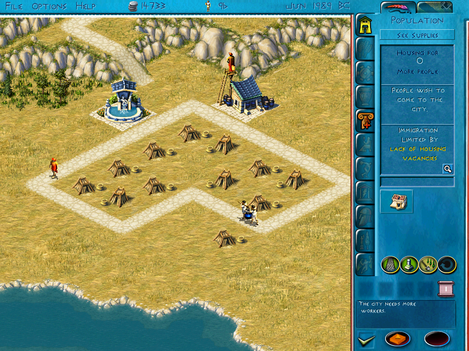
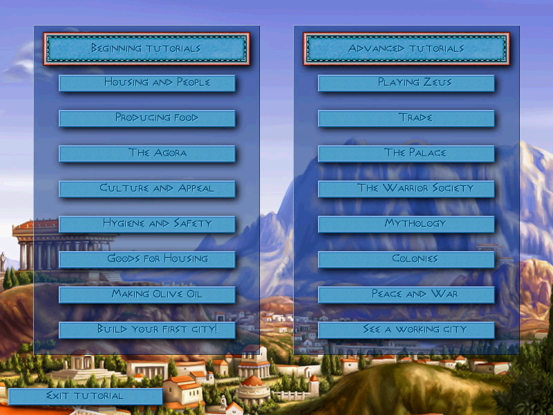

# Zeus + Poséidon sur Mac Apple Silicon

[](https://github.com/nic0lasm/zeus-poseidon-arm64/actions/workflows/build.yml)

**Jouer à *Zeus : Le Maître de l'Olympe* et à son extension *Poséidon* sur un Mac Apple
Silicon : le jeu d'origine, sans Windows, sans Wine et sans machine virtuelle.**

*[English version](README.md)*

<p align="center">
  
  
</p>

*Zeus* (Impressions Games, 2000) est un jeu Windows 32 bits. Les Mac récents ne peuvent plus le
lancer : leur processeur est un ARM, et macOS n'exécute plus de programmes 32 bits depuis des
années. Ce projet fait revivre le jeu en exécutant son code d'origine, non modifié, dans un
petit émulateur x86 cloisonné, et en réécrivant en natif les fonctions Windows dont il a besoin
(fichiers, fenêtre, souris, clavier, DirectDraw, son et vidéo).

Le résultat est le vrai jeu — même simulation, mêmes règles, mêmes sauvegardes — et non une
réécriture.

> **Ce dépôt ne contient aucun fichier du jeu.** Il faut posséder sa propre copie.
> Voir [Mentions légales](#mentions-légales).

## Avancement

| Jalon | Ce qu'on obtient | État |
|---|---|---|
| 1. Le jeu démarre | le vrai menu principal dans une fenêtre Mac | fait |
| 2. Jouable | souris, clavier, tutoriels et aventures, construction, sauvegarde et chargement | fait |
| 3. Complet | musiques, bruitages, vidéos, plein écran | fait |
| 4. Diffusable | performances, application `.app` autonome, compilation automatique, première version publiée | fait |
| 5. Édition française | textes et voix français tirés de vos propres CD d'origine ; résolutions larges | **à venir** |
| 6. Sans émulateur | le code du jeu traduit une fois pour toutes en code natif | prévu |

Ce qui fonctionne aujourd'hui : menus, profils de dirigeant, tutoriels, une ville qui vit
(habitants, logements, construction, calendrier, trésorerie), défilement de la carte,
sauvegarde et chargement, musiques, ambiances, bruitages et vidéo d'introduction. Les sauvegardes sont au format du jeu et restent compatibles avec
l'original.

Limites connues : pas encore de spatialisation 3D du son. Le jeu tourne en anglais tel quel ;
le français est possible avec un pack de langue fabriqué à partir de votre propre exemplaire
français ([docs/languages.md](docs/languages.md), en anglais).

Détail : [docs/roadmap.md](docs/roadmap.md) (en anglais).

## Téléchargement

Une application prête à l'emploi est sur la
[page des versions](https://github.com/nic0lasm/zeus-poseidon-arm64/releases). Elle ne contient
aucun fichier du jeu : au premier lancement, elle demande votre installateur GOG de
*Zeus + Poseidon* et le déballe. Elle n'est pas signée par Apple : la première fois, faites un
clic droit dessus puis *Ouvrir*.

## Compiler depuis les sources

Il faut : un Mac Apple Silicon, les outils en ligne de commande Xcode,
[Homebrew](https://brew.sh) et l'édition GOG de *Zeus + Poseidon*.

```bash
brew install cmake ninja pkgconf sdl2 unicorn ffmpeg innoextract
git clone https://github.com/nic0lasm/zeus-poseidon-arm64.git
cd zeus-poseidon-arm64

# Déballer son propre installateur GOG (le jeu n'est pas installé, seulement déballé)
innoextract -d original/gog /chemin/vers/setup_zeus_and_poseidon_2.1.0.10.exe

cmake -S . -B build -G Ninja && cmake --build build
./build/zeus-run --run original/gog/app/Zeus.exe
```

**⌘F** (ou **⌘↩**) bascule entre fenêtre et plein écran. `python3 tools/make_app.py` fabrique une application `Zeus Poseidon.app` qui demande votre
installateur GOG au premier lancement et le déballe. Le dossier du jeu n'est jamais modifié : tout ce que le jeu écrit (sauvegardes, réglages) va
dans `run/zeus/`. Instructions complètes : [docs/getting-started.md](docs/getting-started.md).

## Principe

Le jeu importe 202 fonctions Windows. Chacune est une petite fonction native dans `src/win32/` ;
une fonction pas encore écrite arrête le programme en affichant son nom, ce qui guide le
travail. Le jeu voit un dossier `C:\Zeus` privé : les lectures aboutissent dans vos fichiers du
jeu, les écritures dans un dossier séparé. Voir [docs/architecture.md](docs/architecture.md).

## Également dans ce dépôt

Le projet a commencé par l'étude des données et du code du jeu ; ce travail est documenté pour
quiconque fabrique des outils pour la communauté *Zeus* / *Poséidon* :

- **Formats de fichiers** — [`formats/sg3.md`](formats/sg3.md) (sprites, `.sg3` + `.555`) et
  [`formats/map.md`](formats/map.md) (cartes et sauvegardes, `.map` / `.sav` / `.pak`), chacun
  avec un lecteur de référence en Python.
- **Outils d'extraction** — lecteurs en pur Python des images CD d'origine, des archives
  InstallShield et des installateurs de mises à jour Wise ([`tools/`](tools/)).
- **Visionneuses** — `zeus-sprites` (tous les sprites du jeu) et `zeus-map` (terrain
  isométrique d'une carte).
- **Notes de rétro-ingénierie** — imports, symboles, comportement du moteur
  ([`analysis/notes/`](analysis/notes/), [docs/reverse-engineering.md](docs/reverse-engineering.md)).

## Communauté

C'est un projet de joueurs, pour les joueurs. Venez dire comment le jeu tourne sur votre Mac,
poser vos questions ou proposer des idées dans les
[Discussions](https://github.com/nic0lasm/zeus-poseidon-arm64/discussions). Les bugs vont dans
les [tickets](https://github.com/nic0lasm/zeus-poseidon-arm64/issues).

Les retours de vraies parties sont aujourd'hui la contribution la plus utile. Le code, l'étude
des formats et les traductions sont bienvenus aussi : voir [CONTRIBUTING.md](CONTRIBUTING.md).

## Mentions légales

Projet de fans indépendant et non commercial, sans lien avec Impressions Games, Sierra,
Activision ou GOG, qui ne le soutiennent ni ne l'approuvent. *Zeus : Le Maître de l'Olympe* et
*Poséidon* sont des marques de leurs propriétaires respectifs.

Le dépôt ne contient que du code source original, des outils et de la documentation. Il ne
distribue aucun exécutable, image, son, texte ou donnée du jeu, et ne contourne aucune
protection : il n'exécute que l'édition GOG, sans DRM, à partir des fichiers que vous
fournissez.

## Licence

GPL-2.0-or-later — voir [LICENSE](LICENSE). Elle ne couvre que le code et la documentation de
ce dépôt, jamais le jeu.

L'émulation x86 repose sur [Unicorn](https://www.unicorn-engine.org/) (GPL-2.0) ; les vidéos
sont décodées par [FFmpeg](https://ffmpeg.org/). Voir [docs/third-party.md](docs/third-party.md).
