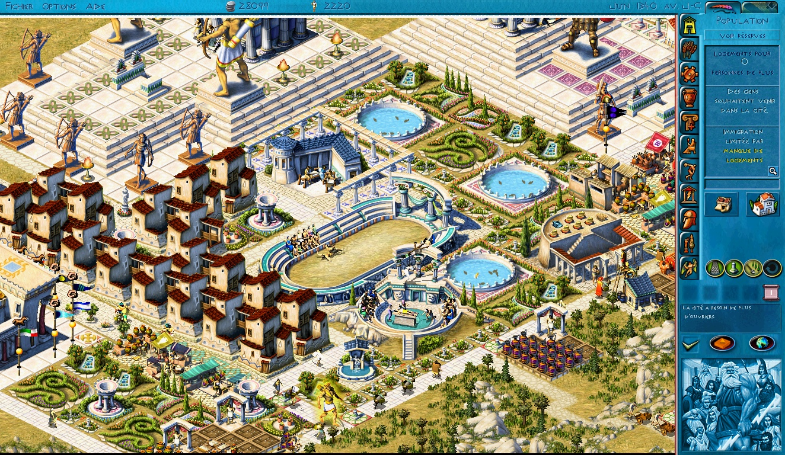
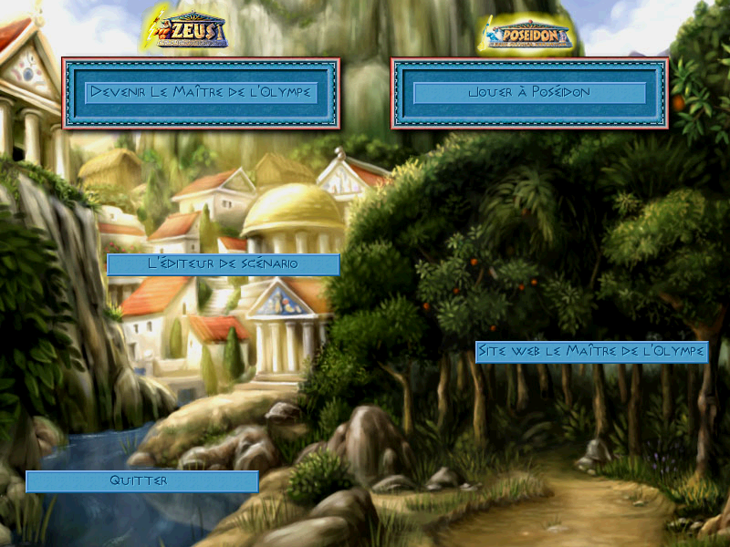

# Zeus + Poseidon on Apple Silicon

[](https://github.com/nic0lasm/zeus-poseidon-arm64/releases/latest)
[](#download)
[](https://github.com/nic0lasm/zeus-poseidon-arm64/actions/workflows/build.yml)
[](docs/equivalence.md)
[](LICENSE)

**Play *Zeus: Master of Olympus* and its *Poseidon* expansion on an Apple Silicon Mac: the
original game, with no Windows, no Wine and no virtual machine.**

*[Version française](README.fr.md)*

<p align="center">
  
</p>
<p align="center">
  
  
</p>
<p align="center"><sub>A large city in wide mode, and the main menu in French, both built from your own copy of the game.</sub></p>

## At a glance

| | |
|---|---|
| **What it is** | The real *Zeus* + *Poseidon* (Impressions Games, 2000): the original, unmodified game code, run on a Mac. Same simulation, same rules, same save files. Not a remake. |
| **Status** | Playable from start to finish. Latest version: **[1.4](https://github.com/nic0lasm/zeus-poseidon-arm64/releases/latest)** (16 October 2026). |
| **Runs on** | Mac with Apple Silicon (M1 or later), macOS 14 or later; Mac with an Intel processor, macOS 15 or later; Linux x86-64 and arm64. See [Download](#download). |
| **You need** | Your own copy of the game, GOG edition (or Steam, [see below](#bought-it-on-steam)). This repository contains no game files ([Legal](#legal)). |
| **Faithful** | Ten replayable scenarios compare every frame and the whole game state, tick by tick, with the original game. |
| **Light** | A small city uses about 23 % of one core (51 to 60 % in 1.0.1). [Figures](#lighter-with-every-version). |

## How it works, in short

*Zeus* is a 32-bit Windows game, and recent Macs can no longer run it. This project runs the
game's **original code** inside a small sandboxed x86 emulator, and rewrites natively the
Windows functions it relies on: files, window, mouse, keyboard, DirectDraw, sound and video. The
hottest parts of the game (most of the city drawing, the costliest parts of the simulation) are
also rewritten by hand in native code, each one proven identical to the original.
[Details below](#how-it-works).

## Download

| Your computer | Download | |
|---|---|---|
| Mac with Apple Silicon (M1 or later), macOS 14+ | **[⬇ Zeus-Poseidon-macos-arm64.zip](https://github.com/nic0lasm/zeus-poseidon-arm64/releases/latest/download/Zeus-Poseidon-macos-arm64.zip)** | available |
| Mac with an Intel processor, macOS 15+ | **[⬇ Zeus-Poseidon-macos-intel.zip](https://github.com/nic0lasm/zeus-poseidon-arm64/releases/latest/download/Zeus-Poseidon-macos-intel.zip)** | available |
| Linux x86-64 (Ubuntu 22.04, Debian 12, Fedora 36 or later) | **[⬇ Zeus-Poseidon-linux-x86_64.AppImage](https://github.com/nic0lasm/zeus-poseidon-arm64/releases/latest/download/Zeus-Poseidon-linux-x86_64.AppImage)** | available |
| Linux arm64 (same distributions) | **[⬇ Zeus-Poseidon-linux-aarch64.AppImage](https://github.com/nic0lasm/zeus-poseidon-arm64/releases/latest/download/Zeus-Poseidon-linux-aarch64.AppImage)** | available |

Every version and its notes: [Releases](https://github.com/nic0lasm/zeus-poseidon-arm64/releases).

### Install and play

1. Open the downloaded zip (double-click it), then double-click **Zeus Poseidon**.
2. macOS refuses to open it the first time, because the application is not notarised by Apple.
   Click **Done** (or *OK*), then open **Apple menu → System Settings → Privacy & Security**,
   scroll down to the message about “Zeus Poseidon” and click **Open Anyway**; confirm with your
   password or Touch ID, then click **Open**. This is needed once only. *(Wording may differ
   slightly between macOS versions.)*
3. Pick your GOG installer (`setup_zeus_and_poseidon_….exe`; the file picker opens in
   Downloads) or drop it on the application icon. It is unpacked once (about a minute, 800 MB);
   then play. To get it from a Mac: sign in at **GOG.com → your library → Zeus + Poseidon →
   Download offline backup game installers → Windows** (download the `.exe` and the `.bin` files
   next to it, if any).

**In French?** Hold the Option key (⌥) at launch and choose *Another language, from the original
CDs…*: the application builds a French pack from the images of your own CDs
([details](docs/languages.md)).

**On Linux:** make the AppImage executable (`chmod +x`, or *Properties → Allow executing*) and run
it. It asks for the GOG installer the same way (with zenity or kdialog if installed, otherwise in
the terminal); start it with `ZEUS_ASK_LANGUAGE=1` for the language choice.

### Bought it on Steam?

According to SteamDB, the Steam edition holds the same files as GOG's (same names and sizes,
`Zeus.exe` included, and no Steam library), but nobody has tried it yet ([#128](https://github.com/nic0lasm/zeus-poseidon-arm64/issues/128)).
- **On Linux**, install it with Steam (Proton): the application finds it by itself in your Steam
  libraries, nothing to pick.
- **On a Mac**, Steam cannot install this Windows-only game: copy the `Zeus + Poseidon` folder
  from a Windows PC (`Steam\steamapps\common`), then choose it with **Folder…**.

If its `Zeus.exe` is not GOG's, the application says so once and shows its checksum: please
report it on [#128](https://github.com/nic0lasm/zeus-poseidon-arm64/issues/128).

## What you get

- **The whole game:** the sixteen tutorials, the Zeus and Poseidon adventures, the adventure
  editor, gods, heroes, monsters and disasters, save and load.
- **Sound and video:** music, ambience, 3D sound, effects and the intro video.
- **A modern window:** window or full screen (⌘F), sharp at any size, and a wide mode fitted to
  your screen (pick the largest resolution in the game's display options).
- **Your language:** English out of the box, French (and other editions, see
  [#24](https://github.com/nic0lasm/zeus-poseidon-arm64/issues/24)) built from your own CDs.
- **Small comforts:** mouse wheel in lists, pause when you switch to another application, start
  in under a second.
- **Faithful by proof:** ten replayable scenarios compare every frame and the whole game state,
  tick by tick, with the original game, so a change that alters a single pixel or a single
  number of the simulation cannot slip in ([equivalence.md](docs/equivalence.md)).

## Lighter with every version

Each version moves more of the work from the emulated original to native code written by hand,
each part proven identical to the original.

| Measure | 1.0.1 | 1.1 | 1.2 | 1.3 | 1.4 |
|---|---:|---:|---:|---:|---:|
| Small city, real time on a Mac (share of one core) | 51–60 % | about 35 % | about 23 % | not measured yet ([#127](https://github.com/nic0lasm/zeus-poseidon-arm64/issues/127), anyone with a Mac) | |
| Simulation tick of a large city (bench, `working-city`) | | 5.3–5.8 ms | 1.6 ms | 1.6 ms | **1.6 ms** |
| City drawing kept in native code (second pass, large city) | | | 97 % of the tiles | 97 % of the tiles | **97 %** of the tiles |
| Game frozen by a save (large city, real time) | | | 3.85 s | 0.33 s | **0.33 s** |
| Colour conversion of a 1024×768 frame for the window | | | | 4.1 ms | **0.65 ms** |

Also in 1.2: window frames in native code (10 to 12 % less CPU over the large-city and options
scenarios). New in 1.3: one-line texts in native code, 7 to 9 % less CPU in real play
on the large city ([#113](https://github.com/nic0lasm/zeus-poseidon-arm64/pull/113)). New in 1.4: a lighter display, 7 to 12 % less
CPU with the window visible ([#131](https://github.com/nic0lasm/zeus-poseidon-arm64/pull/131)).

**Engine progress:** 322 of the 4,872 functions of the GOG executable are understood (named,
documented or native) and 24 are replaced whole by native code; native code does 53.2 % of the
game's computation on `working-city`, plus 17.1 % in functions that are partly native.
[Code map and counters](docs/engine/README.md).

## What's next

The speed lots that a player could feel in the emulated code are done; what is left there weighs
about 1 % of the run per piece. The next steps go to what players notice
([full plan](docs/roadmap.md#after-13-review-of-16-october-2026-evening), [1.4 milestone](https://github.com/nic0lasm/zeus-poseidon-arm64/milestone/12)):

Done in 1.4: **a lighter display** ([#125](https://github.com/nic0lasm/zeus-poseidon-arm64/issues/125)); **loading a game** measured at
0.16 s, nothing to speed up ([#126](https://github.com/nic0lasm/zeus-poseidon-arm64/issues/126)). Next:

1. **More editions**: language packs ([#24](https://github.com/nic0lasm/zeus-poseidon-arm64/issues/24)) and the Steam edition ([#128](https://github.com/nic0lasm/zeus-poseidon-arm64/issues/128)). If you own one, your report helps more than any new feature.

Longer term, the aim stays the same: keep *Zeus* and *Poseidon* playable for as long as people
want to play them. A fully native engine (2.0, no emulator, the way Julius did for
*Caesar III*) is on hold; the code map, the subsystem pages in [`docs/engine/`](docs/engine/) and
the bench stay ready for it. No dates are promised.

## Version history

| Version | Highlights |
|---|---|
| [**1.4**](https://github.com/nic0lasm/zeus-poseidon-arm64/releases/tag/v1.4) | lighter display: frames copied in place and the window's texture in the renderer's format (7 to 12 % less CPU with the window visible; colour conversion 4.1 → 0.65 ms per frame) |
| [**1.3**](https://github.com/nic0lasm/zeus-poseidon-arm64/releases/tag/v1.3) | saves without a pause (3.85 s → 0.33 s on a large city); Intel Mac archive (macOS 15+); Linux AppImages (x86-64, arm64); one-line texts in native code (7 to 9 % less CPU) |
| [**1.2**](https://github.com/nic0lasm/zeus-poseidon-arm64/releases/tag/v1.2) | lighter: city drawing, window frames and texts in native code (small city at about 23 % of a core instead of 35 %); simulation tick of a large city about three times faster; ten scenarios proven identical to the original, tick by tick |
| [**1.1**](https://github.com/nic0lasm/zeus-poseidon-arm64/releases/tag/v1.1) | first launch in fewer clicks (one-click download, picker in Downloads, no language question); taller wide modes; city ground drawn natively (small city 35 % of a core instead of about 50 %) |
| [**1.0.1**](https://github.com/nic0lasm/zeus-poseidon-arm64/releases/tag/v1.0.1) | the game at its real speed (it ran at two thirds of it since 0.2); native sprite dispatcher |
| [**1.0**](https://github.com/nic0lasm/zeus-poseidon-arm64/releases/tag/v1.0) | first stable version: the code of 0.9, played through by hand |

<details>
<summary>Older versions (0.1 to 0.9)</summary>

| Version | Highlights |
|---|---|
| [0.9](https://github.com/nic0lasm/zeus-poseidon-arm64/releases/tag/v0.9) | release candidate: starts in under a second, real resolution shown in wide mode, lighter on memory |
| [0.4](https://github.com/nic0lasm/zeus-poseidon-arm64/releases/tag/v0.4) | 3D sound, native drawing routines, mouse wheel, pause in the background, much wider automated tests |
| [0.3](https://github.com/nic0lasm/zeus-poseidon-arm64/releases/tag/v0.3) | wide screen; language packs built by the application from the original CDs |
| [0.2](https://github.com/nic0lasm/zeus-poseidon-arm64/releases/tag/v0.2) | French; half the CPU; the application opens the GOG installer itself |
| [0.1](https://github.com/nic0lasm/zeus-poseidon-arm64/releases/tag/v0.1) | first preview: menus, tutorials, building, save and load, music, sound, intro video, full screen |

</details>

The archives of 0.1 and 0.2 were withdrawn (they carried build paths of the machine that made
them); every change is described in [CHANGELOG.md](CHANGELOG.md).

## Build from source

Requirements: an Apple Silicon Mac, the Xcode command line tools, [Homebrew](https://brew.sh),
and the GOG edition of *Zeus + Poseidon*.

```bash
brew install cmake ninja pkgconf sdl2 unicorn ffmpeg innoextract
git clone https://github.com/nic0lasm/zeus-poseidon-arm64.git
cd zeus-poseidon-arm64

# Unpack your own GOG installer (the game is never installed on the Mac, only unpacked)
innoextract -d original/gog /path/to/setup_zeus_and_poseidon_2.1.0.10.exe

cmake -S . -B build -G Ninja && cmake --build build
./build/zeus-run --run original/gog/app/Zeus.exe --wide auto
```

`python3 tools/make_app.py` builds a double-clickable `Zeus Poseidon.app`. The game folder is
never modified: everything the game writes (saves, settings) goes to `run/zeus/`. Options,
scripted runs and troubleshooting: [docs/getting-started.md](docs/getting-started.md).

## How it works

```
        Zeus.exe (original x86 code, unmodified)
                      │ runs inside
        ┌─────────────▼──────────────┐
        │  sandboxed x86 emulator    │   Unicorn engine, 32-bit address space
        └─────────────┬──────────────┘
                      │ every Windows call lands on
        ┌─────────────▼──────────────┐
        │  native host (C++17)       │   KERNEL32 · USER32 · GDI32 · DirectDraw
        │  src/win32/                │   Miles Sound · Bink · Intel JPEG
        └─────────────┬──────────────┘   + hot game routines rewritten natively
                      │
    SDL2 · FFmpeg (Bink, MP3) · macOS ImageIO
```

The game imports 202 Windows functions. Each one is a small native function in `src/win32/`; a
function that is not written yet stops the program and names itself, which is what drove the
work. The game's hottest routines (sprite drawing and its dispatcher, most of the city
drawing, window frames and texts, and the costliest parts of the simulation: route searches,
walkers, composite buildings) also run natively, each proven identical frame by frame and
tick by tick. The game sees a private `C:\Zeus` folder: reads
fall through to your game files, writes go to a separate directory.

More: [docs/architecture.md](docs/architecture.md) and the findings in
[docs/reverse-engineering.md](docs/reverse-engineering.md).

## Also in this repository

The project started as a study of the game's data and code, and that work is documented here
for anyone building tools for the *Zeus* / *Poseidon* community:

- **File formats:** [`formats/`](formats/) describes the sprites (`.sg3` + `.555`), maps,
  saved games (with their compression), adventures, texts and in-game help, each with a
  reference reader in Python; more to come ([#30](https://github.com/nic0lasm/zeus-poseidon-arm64/issues/30)).
- **Extraction tools:** pure-Python readers for the original CD images, InstallShield
  cabinets and Wise patch installers ([`tools/`](tools/)).
- **Viewers:** `zeus-sprites` (browse every sprite of the game) and `zeus-map` (isometric
  terrain of any map).
- **Reverse-engineering notes:** imports, symbols, engine behaviour
  ([`analysis/notes/`](analysis/notes/), [docs/reverse-engineering.md](docs/reverse-engineering.md)).

## Community

This is a project by and for the players of the game. Say how it runs on your Mac, ask questions
or share ideas in the [Discussions](https://github.com/nic0lasm/zeus-poseidon-arm64/discussions);
bugs go to the [issue tracker](https://github.com/nic0lasm/zeus-poseidon-arm64/issues).

The most useful help right now:

- **Play and report:** an adventure played through, on your Mac model.
- **Another language edition?** Try a pack from your CDs and tell us ([#24](https://github.com/nic0lasm/zeus-poseidon-arm64/issues/24)).
- **Code:** see the [open issues](https://github.com/nic0lasm/zeus-poseidon-arm64/issues) and
  [CONTRIBUTING.md](CONTRIBUTING.md).

## Legal

This is an independent, non-commercial fan project. It is not affiliated with, endorsed by or
supported by Impressions Games, Sierra, Activision or GOG. *Zeus: Master of Olympus* and
*Poseidon: Master of Atlantis* are trademarks of their respective owners.

The repository contains only original source code, tools and documentation. It ships no
executable, artwork, sound, text or data from the game, and it does not circumvent any copy
protection: it only runs the DRM-free GOG edition, from files you provide.

## License

GPL-2.0-or-later, see [LICENSE](LICENSE). This covers the code and documentation of this
repository only, never the game.

The x86 emulation relies on the [Unicorn engine](https://www.unicorn-engine.org/) (GPL-2.0);
videos are decoded with [FFmpeg](https://ffmpeg.org/). See [docs/third-party.md](docs/third-party.md).
