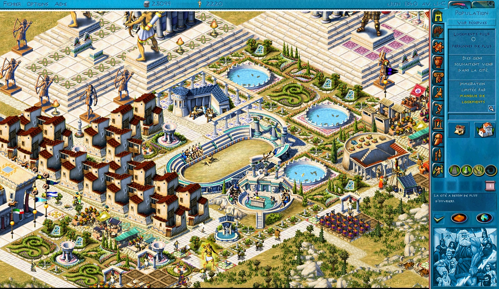
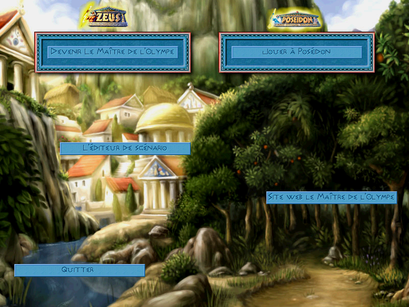
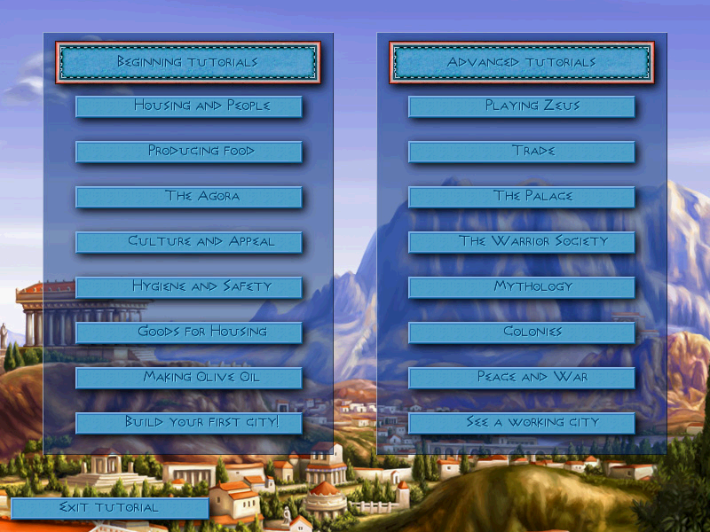

# Zeus + Poseidon on Mac and Linux

[](https://github.com/nic0lasm/zeus-poseidon-arm64/releases/latest)
[](#download)
[](#download)
[](https://github.com/nic0lasm/zeus-poseidon-arm64/actions/workflows/build.yml)
[](docs/equivalence.md)
[](LICENSE)

**Play *Zeus: Master of Olympus* and its *Poseidon* expansion on a Mac (Apple Silicon or Intel)
or on Linux: the original game, with no Windows, no Wine and no virtual machine.**

*[Version française](README.fr.md)*

<p align="center">
  
</p>
<p align="center">
  
  
</p>
<p align="center"><sub>A large city in wide mode, and the main menu in French, both built from your own copy of the game.</sub></p>

## At a glance

| | |
|---|---|
| **What it is** | The real *Zeus* + *Poseidon* (Impressions Games, 2000): the original, unmodified game code, run in a small x86 emulator. Same simulation, same rules, same save files. Not a remake. |
| **Status** | Playable from start to finish. Latest version: **[1.7.2](https://github.com/nic0lasm/zeus-poseidon-arm64/releases/latest)** (10 November 2026). |
| **Runs on** | Mac with Apple Silicon or Intel, macOS 11 (Big Sur) or later; Linux x86-64 and arm64. |
| **You need** | Your own copy of the game, GOG edition (or [Steam](#bought-it-on-steam)). This repository contains no game files ([Legal](#legal)). |
| **Faithful** | Ten replayable scenarios compare every frame and the whole game state, tick by tick, with the original game. |
| **Light** | A small city uses about 23 % of one core (51 to 60 % in 1.0.1). [Figures](#how-it-works). |

## Download

| Your computer | Download |
|---|---|
| Mac with Apple Silicon (M1 or later), macOS 11+ | **[⬇ Zeus-Poseidon-macos-arm64.zip](https://github.com/nic0lasm/zeus-poseidon-arm64/releases/latest/download/Zeus-Poseidon-macos-arm64.zip)** |
| Mac with an Intel processor, macOS 11+ | **[⬇ Zeus-Poseidon-macos-intel.zip](https://github.com/nic0lasm/zeus-poseidon-arm64/releases/latest/download/Zeus-Poseidon-macos-intel.zip)** |
| Linux x86-64 (Ubuntu 22.04, Debian 12, Fedora 36 or later) | **[⬇ Zeus-Poseidon-linux-x86_64.AppImage](https://github.com/nic0lasm/zeus-poseidon-arm64/releases/latest/download/Zeus-Poseidon-linux-x86_64.AppImage)** |
| Linux arm64 (same distributions) | **[⬇ Zeus-Poseidon-linux-aarch64.AppImage](https://github.com/nic0lasm/zeus-poseidon-arm64/releases/latest/download/Zeus-Poseidon-linux-aarch64.AppImage)** |

Every version and its notes: [Releases](https://github.com/nic0lasm/zeus-poseidon-arm64/releases).
On macOS 11 to 13 the Mac archives are checked by the CI but not yet on a real Mac: if you have
one, a word on [#139](https://github.com/nic0lasm/zeus-poseidon-arm64/issues/139) helps.

### Install and play

1. Open the downloaded zip, then double-click **Zeus Poseidon**.
2. The first time, macOS refuses to open it (the application is not notarised by Apple). Click
   **Done**, then in **System Settings → Privacy & Security**, scroll down to “Zeus Poseidon”
   and click **Open Anyway**. Once only. *(On macOS 11 and 12: **System Preferences → Security &
   Privacy → General**.)*
3. Pick your GOG installer (`setup_zeus_and_poseidon_….exe`, plus its `.bin` files if any) or
   drop it on the application icon. It is unpacked once (about a minute, 800 MB); then play.
   From a Mac, get it at **GOG.com → your library → Zeus + Poseidon → Download offline backup
   game installers → Windows**.

**In French?** Hold Option (⌥) at launch and choose *Another language, from the original CDs…*:
the application builds a French pack from your own CDs ([details](docs/languages.md)).

**On Linux:** make the AppImage executable (`chmod +x`) and run it; it asks for the GOG
installer the same way. Start it with `ZEUS_ASK_LANGUAGE=1` for the language choice.

### Bought it on Steam?

The Steam edition is the same game as GOG's, same `Zeus.exe`
([#128](https://github.com/nic0lasm/zeus-poseidon-arm64/issues/128)). On Linux, install it with
Steam (Proton) and the application finds it by itself. On a Mac, it is found by itself in a
CrossOver, Whisky or Wine bottle; otherwise copy the `Zeus + Poseidon` folder from a Windows PC
(`Steam\steamapps\common`) and choose it with **Folder…**.

## What you get

- **The whole game:** the sixteen tutorials, the Zeus and Poseidon adventures, the adventure
  editor, save and load, music, 3D sound and the intro video.
- **A modern window:** window or full screen (⌘F), sharp at any size, a wide mode fitted to your
  screen, and the game's own cursors, sharp on Retina.
- **Smooth:** walkers and animations at up to about 60 frames per second instead of 15, a city
  that glides as it scrolls, with the arrows or W A S D.
- **Your language:** English out of the box, French and other editions built from your own CDs
  ([#24](https://github.com/nic0lasm/zeus-poseidon-arm64/issues/24)).
- **Faithful by proof:** a change that alters a single pixel or a single number of the
  simulation cannot slip in ([equivalence.md](docs/equivalence.md)).

## What's next

The game runs on every Mac from macOS 11 and on Linux, and is proven identical to the original.
The project is now maintained rather than extended: reports from players come first, and a fix
ships as a 1.7.x release ([plan](docs/roadmap.md#after-17-review-of-24-october-2026)). The aim
stays the same: keep *Zeus* and *Poseidon* playable for as long as people want to play them. A
fully native engine (2.0, the way Julius did for *Caesar III*) is on hold, with no date promised.

## Version history

| Version | Highlights |
|---|---|
| [**1.7.2**](https://github.com/nic0lasm/zeus-poseidon-arm64/releases/tag/v1.7.2) | wide modes: nothing left of the previous screen around the menus ([#159](https://github.com/nic0lasm/zeus-poseidon-arm64/issues/159)) |
| [**1.7.1**](https://github.com/nic0lasm/zeus-poseidon-arm64/releases/tag/v1.7.1) | smoother: a frame for every simulation tick, smooth scrolling, W A S D; the game's own cursors; menus centred in wide modes; Steam found in Wine bottles; tools to translate into a new language |
| [**1.7**](https://github.com/nic0lasm/zeus-poseidon-arm64/releases/tag/v1.7) | older Macs: both Mac archives run from macOS 11, Intel Macs from 2013 included |
| [**1.6**](https://github.com/nic0lasm/zeus-poseidon-arm64/releases/tag/v1.6) | Mac applications unpack the GOG installer by themselves again ([#134](https://github.com/nic0lasm/zeus-poseidon-arm64/issues/134)) |
| [**1.5**](https://github.com/nic0lasm/zeus-poseidon-arm64/releases/tag/v1.5) | Steam edition found by itself; `Zeus.exe` checked at launch |

<details>
<summary>Older versions (0.1 to 1.4)</summary>

| Version | Highlights |
|---|---|
| [1.4](https://github.com/nic0lasm/zeus-poseidon-arm64/releases/tag/v1.4) | lighter display (7 to 12 % less CPU with the window visible) |
| [1.3](https://github.com/nic0lasm/zeus-poseidon-arm64/releases/tag/v1.3) | saves without a pause (3.85 s → 0.33 s); Intel Mac archive; Linux AppImages |
| [1.2](https://github.com/nic0lasm/zeus-poseidon-arm64/releases/tag/v1.2) | lighter: city drawing, window frames and texts in native code; ten scenarios proven identical |
| [1.1](https://github.com/nic0lasm/zeus-poseidon-arm64/releases/tag/v1.1) | first launch in fewer clicks; taller wide modes; city ground drawn natively |
| [1.0.1](https://github.com/nic0lasm/zeus-poseidon-arm64/releases/tag/v1.0.1) | the game at its real speed |
| [1.0](https://github.com/nic0lasm/zeus-poseidon-arm64/releases/tag/v1.0) | first stable version, played through by hand |
| [0.9](https://github.com/nic0lasm/zeus-poseidon-arm64/releases/tag/v0.9) | starts in under a second, lighter on memory |
| [0.4](https://github.com/nic0lasm/zeus-poseidon-arm64/releases/tag/v0.4) | 3D sound, native drawing routines, mouse wheel |
| [0.3](https://github.com/nic0lasm/zeus-poseidon-arm64/releases/tag/v0.3) | wide screen; language packs from the original CDs |
| [0.2](https://github.com/nic0lasm/zeus-poseidon-arm64/releases/tag/v0.2) | French; half the CPU; the GOG installer opened by the application |
| [0.1](https://github.com/nic0lasm/zeus-poseidon-arm64/releases/tag/v0.1) | first preview |

</details>

Every change is described in [CHANGELOG.md](CHANGELOG.md).

## How it works

```
        Zeus.exe (original x86 code, unmodified)
                      │ runs inside
        ┌─────────────▼──────────────┐
        │  sandboxed x86 emulator    │   Unicorn engine, 32-bit address space
        └─────────────┬──────────────┘
                      │ every Windows call lands on
        ┌─────────────▼──────────────┐
        │  native host (C++17)       │   KERNEL32 · USER32 · GDI32 · DirectDraw
        │  src/win32/                │   Miles Sound · Bink · Intel JPEG
        └─────────────┬──────────────┘   + hot game routines rewritten natively
                      │
    SDL2 · FFmpeg (Bink, MP3) · macOS ImageIO
```

Each of the 202 Windows functions the game imports is a small native function in `src/win32/`.
The game's hottest routines (most of the city drawing, texts, route searches, walkers) are also
rewritten by hand in native code, each one proven identical frame by frame and tick by tick.
The game folder is never written to. More: [docs/architecture.md](docs/architecture.md),
[docs/reverse-engineering.md](docs/reverse-engineering.md).

<details>
<summary>Lighter with every version: the figures</summary>

| Measure | 1.0.1 | 1.1 | 1.2 | 1.3 | 1.4 |
|---|---:|---:|---:|---:|---:|
| Small city, real time on a Mac (share of one core) | 51–60 % | about 35 % | about 23 % | | |
| Simulation tick of a large city (bench, `working-city`) | | 5.3–5.8 ms | 1.6 ms | 1.6 ms | **1.6 ms** |
| Game frozen by a save (large city) | | | 3.85 s | 0.33 s | **0.33 s** |
| Colour conversion of a 1024×768 frame | | | | 4.1 ms | **0.65 ms** |

322 of the 4,872 functions of the GOG executable are understood and 24 are replaced whole by
native code, which does 53.2 % of the game's computation on `working-city`
([code map](docs/engine/README.md)). A new measure on a Mac is welcome on
[#127](https://github.com/nic0lasm/zeus-poseidon-arm64/issues/127).

</details>

### Build from source

On an Apple Silicon Mac with the Xcode command line tools and [Homebrew](https://brew.sh):

```bash
brew install cmake ninja pkgconf sdl2 unicorn ffmpeg innoextract
git clone https://github.com/nic0lasm/zeus-poseidon-arm64.git
cd zeus-poseidon-arm64
innoextract -d original/gog /path/to/setup_zeus_and_poseidon_2.1.0.10.exe   # your own installer
cmake -S . -B build -G Ninja && cmake --build build
./build/zeus-run --run original/gog/app/Zeus.exe --wide auto
```

`python3 tools/make_app.py` builds a double-clickable `Zeus Poseidon.app`. Options and
troubleshooting: [docs/getting-started.md](docs/getting-started.md).

### Also in this repository

For anyone building tools for the *Zeus* / *Poseidon* community: the game's
[file formats](formats/) (sprites, fonts, maps, saves, adventures, texts) with reference readers
in Python, extraction [tools](tools/) for the original CDs and installers, the `zeus-sprites` and
`zeus-map` viewers, and [reverse-engineering notes](analysis/notes/).

## Community

This is a project by and for the players of the game. Come and say hello in the
[Discussions](https://github.com/nic0lasm/zeus-poseidon-arm64/discussions): tell us which Mac or
Linux you play on in [General](https://github.com/nic0lasm/zeus-poseidon-arm64/discussions/categories/general),
ask anything in [Q&A](https://github.com/nic0lasm/zeus-poseidon-arm64/discussions/categories/q-a)
(no question is too small), show your Athens or your Atlantis in
[Show and tell](https://github.com/nic0lasm/zeus-poseidon-arm64/discussions/categories/show-and-tell).

The most useful help right now:

- **Play and report:** an adventure played through, on your computer; bugs go to the
  [issues](https://github.com/nic0lasm/zeus-poseidon-arm64/issues).
- **Translations:** a pack from your CDs, or a new language: Ukrainian is already playable
  ([#24](https://github.com/nic0lasm/zeus-poseidon-arm64/issues/24),
  [how it was made](tools/examples/lang/uk/README.md)).
- **Puzzles for tool makers:** a few file formats are still undocumented
  ([#30](https://github.com/nic0lasm/zeus-poseidon-arm64/issues/30), good first issues).
- **Code:** [CONTRIBUTING.md](CONTRIBUTING.md).

If this brought back a game of your childhood, a ⭐ on the repository helps other players find it.

### Thank you

Reports and contributions from players make this project better. Thank you to:

- [**@northdakota**](https://github.com/northdakota) (Volodymyr Polishchuk), who proved the
  Steam `Zeus.exe` is GOG's ([#128](https://github.com/nic0lasm/zeus-poseidon-arm64/issues/128)),
  then sent most of 1.7.1 and 1.7.2: smooth motion and scrolling, W A S D, the game's cursors,
  menus centred in wide modes, Steam in Wine bottles, the fonts documented and the tools to
  translate the game ([#148](https://github.com/nic0lasm/zeus-poseidon-arm64/pull/148) to
  [#165](https://github.com/nic0lasm/zeus-poseidon-arm64/pull/165)). Each one traced to the
  game's own code, checked against the ten scenarios and shown before and after: a model of
  what a contribution can be.
- [**@MohammadBnei**](https://github.com/MohammadBnei), who found that the application could not
  unpack the GOG installer on a clean Mac and proposed the fix that shipped in 1.6
  ([#134](https://github.com/nic0lasm/zeus-poseidon-arm64/issues/134)).
- [**@enkhamar17**](https://github.com/enkhamar17), who reported the menus out of place in wide
  mode, with screenshots ([#159](https://github.com/nic0lasm/zeus-poseidon-arm64/issues/159)).

Your name can be next: every report, test or pull request counts.

## Legal

This is an independent, non-commercial fan project, not affiliated with or endorsed by
Impressions Games, Sierra, Activision or GOG. *Zeus: Master of Olympus* and *Poseidon: Master of
Atlantis* are trademarks of their respective owners. The repository ships no executable,
artwork, sound, text or data from the game, and circumvents no copy protection: it only runs the
DRM-free GOG edition, from files you provide.

## License

GPL-2.0-or-later, see [LICENSE](LICENSE), for the code and documentation of this repository
only, never the game. It relies on the [Unicorn engine](https://www.unicorn-engine.org/) and
[FFmpeg](https://ffmpeg.org/); see [docs/third-party.md](docs/third-party.md).
