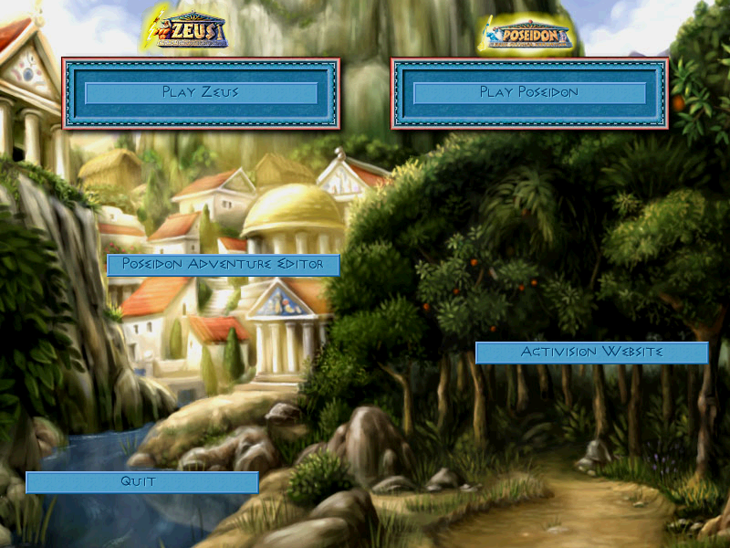

# Getting started

## Requirements

- A Mac with Apple Silicon (developed on an M1 MacBook Air; any M-series Mac should do).
- Xcode command line tools: `xcode-select --install`.
- [Homebrew](https://brew.sh).
- Your own copy of the **GOG edition** of *Zeus + Poseidon* (installer
  `setup_zeus_and_poseidon_2.1.0.10.exe`).

Only the GOG edition is supported: it is DRM-free. The original CD executables are wrapped by
SecuROM copy protection; this project does not run them and does not circumvent the protection.

## Install the build dependencies

```bash
brew install cmake ninja pkgconf sdl2 unicorn ffmpeg innoextract
```

| Package | Used for |
|---|---|
| `cmake`, `ninja`, `pkgconf` | build |
| `sdl2` | window, input, display, audio output |
| `unicorn` | x86 emulation |
| `ffmpeg` | decoding the Bink videos |
| `innoextract` | unpacking the GOG installer |

## Unpack the game

From the repository root:

```bash
innoextract -d original/gog /path/to/setup_zeus_and_poseidon_2.1.0.10.exe
```

The game ends up in `original/gog/app/`. Nothing under `original/` is tracked by git, and the
host never writes there.

The executable this project was developed against:

```
original/gog/app/Zeus.exe   2,527,232 bytes
SHA-256  382bcd286192a06eb8fdc45f5c37390a19999f5db9c940c3ce2dfcd775e90a57
```

Check yours with `shasum -a 256 original/gog/app/Zeus.exe`. Another build of the game may work
but has not been tried.

## Build

```bash
cmake -S . -B build -G Ninja
cmake --build build
./build/zeus-run --selftest      # checks the emulator and the host-call mechanism
./build/zeus-tests               # tests the host parts that do not need the game
./build/zeus-run --bench         # measures the emulator
```

## Play

```bash
./build/zeus-run --run original/gog/app/Zeus.exe
```



The game opens in an 800×600 window. **⌘F** or **⌘↩** switches to full screen and back; the
picture keeps its 4:3 proportions and stays sharp at any size. For a larger view of the city,
choose *Options → Display options → 1024 x 768* in the game. Started with `--wide auto` (the
application always does), that mode becomes a wide one fitted to your screen (taller than 768 lines on a screen taller than
16:9), and the option
shows its real size. Saves and settings are written to `run/zeus/`.

The intro video plays first; press Esc to skip it. The mouse wheel, or a two-finger swipe,
scrolls the game's lists and texts. When you switch to another application the game pauses and
goes quiet, as it did under Windows; it carries on when you come back.

## Build the application

```bash
python3 tools/make_app.py
open "build/Zeus Poseidon.app"
```

This assembles a self-contained `Zeus Poseidon.app`: the program plus the libraries it needs,
signed locally. On first launch it asks for the game: either the GOG installer itself, which it
unpacks (about a minute, 800 MB), or a folder where the game is already unpacked. The choice
is remembered. Saves and settings go to
`~/Library/Application Support/Zeus Poseidon/`. The bundle contains no game files.

That bundle is meant for your own Mac: it embeds Homebrew's FFmpeg build, whose licence terms
differ from Unicorn's, so it must not be redistributed.

### A bundle that can be shared

```bash
export MACOSX_DEPLOYMENT_TARGET=11.0
python3 tools/build_mac_deps.py      # SDL 2, Unicorn, innoextract built for macOS 11, in build/deps/mac
python3 tools/build_ffmpeg.py        # reduced FFmpeg (Bink only, LGPL), built in build/deps
python3 tools/fetch_python.py        # standalone Python, for building language packs in the app
PKG_CONFIG_PATH=$PWD/build/deps/mac/lib/pkgconfig cmake -S . -B build/diffusion -G Ninja \
  -DCMAKE_BUILD_TYPE=Release -DCMAKE_PREFIX_PATH=$PWD/build/deps/mac -DZEUS_FFMPEG=build/deps/ffmpeg
cmake --build build/diffusion --target zeus-run
python3 tools/make_app.py --binary build/diffusion/zeus-run "build/diffusion/Zeus Poseidon.app"
```

The result (about 50 MB) carries its licence notices ([third-party.md](third-party.md)) and
starts on macOS 11 or later: Homebrew's libraries are built for the Mac that built them (macOS 14
or 15 on GitHub's), so the shared bundle takes its own (#139).
The tool strips debugging information and checks that no file of the bundle mentions your home
folder. It is signed locally only, not notarised by Apple: on another Mac, the first launch
needs *System Settings → Privacy & Security → Open Anyway* (on macOS 15 and later, right-click → *Open* no longer works).

## Options

| Option | Effect |
|---|---|
| `--write-dir DIR` | where the game's writes go (default `run/zeus`) |
| `--language DIR` | language pack (see [languages.md](languages.md)) |
| `--trace` | print every Windows call |
| `--deterministic` | virtual clock and no sound: two runs of the same script give the same frames |
| `--frame-log FILE.txt` | write a hash of every displayed frame |
| `--watch-call ADDRESS` | list the call sites of a game function (hexadecimal address) |
| `--count ADDRESS[,ADDRESS…]` | print, on exit, how many times execution reached each game address (hexadecimal), one line per address; works on functions rewritten natively too |
| `--ticks` | print, on exit, the simulation ticks per second (passes on `0x00513A30`), measured in real time over the active play (gaps longer than one second, such as a pause or an open message, are left out); meaningless with `--deterministic` |
| `--dump-data FILE.bin` | write the game's variables at exit |
| `--profile FILE.tsv` | time spent per block of game code (slow); summarise with `tools/profile_report.py` |
| `--call-graph FILE.tsv` | every call between game functions and the time of every block, inside the simulation tick or outside it (slow); summarise with `tools/simulation_map.py` ([simulation](engine/simulation.md)) |
| `--time-span START:RETURN[,…]` | print, on exit, the real time spent from a game address to another (a function's entry and the return address after its call), per pass and as a share of the run |
| `--no-native` | emulate everything, without the host rewrites of some game functions |
| `--check-audio FOLDER` | (alone, instead of `--run`) decode every sound file of a folder the way the mixer does |
| `--state-log FILE` | write a fingerprint of every memory zone of the game state at each simulation tick (`docs/equivalence.md`) |
| `--verify ADDRESS[:END]` | run each call of this game function (or this piece of code) twice from the same state, native replacements off then on, compare registers and memory, stop at the first difference (`docs/equivalence.md`) |
| `--verify-every N` | with `--verify`, check one pass in N |
| `--counts` | print, on exit, how many times each Windows function was called and the time spent in it |
| `--trace-only PREFIX` | trace only functions whose name starts with PREFIX, e.g. `mss32.dll` |
| `--headless` | hidden window, sound muted |
| `--mute` | sound muted |
| `--fullscreen` | start in full screen |
| `--wide auto` or `--wide WxH` | turn the game's 1024×768 mode into a wide mode |
| `--frames N`, `--seconds S` | stop after N displayed frames or S seconds |
| `--screenshot FILE.bmp` | save the last displayed frame |
| `--window-shot FILE.bmp` | save what the window shows, scaling included |
| `--script "T:ACTION; …"` | replay input at T seconds: `click X,Y`, `rclick X,Y`, `move X,Y`, `down X,Y` and `up X,Y` (press and release separately, to drag), `wheel N`, `blur` and `focus` (window sent to the background and back), `key CODE` (Windows virtual key), `char CODE`, `shot FILE.bmp` |

Example — reach the main menu without a window and capture it:

```bash
./build/zeus-run --run original/gog/app/Zeus.exe --headless --frames 40 \
    --screenshot menu.bmp --write-dir build/trial
```

Example — measure the game speed and count calls to the drawing loop in a large city (the
right-click at 45 s closes its opening message, which pauses the game). At the default 90 %
speed the result is 45 ticks a second:

```bash
./build/zeus-run --run original/gog/app/Zeus.exe --headless --seconds 75 --write-dir build/trial-2 \
    --ticks --count 0x00458170 \
    --script "5:key 27; 12:click 220,101; 17:char 78; 20:click 556,320; 27:click 644,523; 33:click 588,476; 45:rclick 300,300"
```

## If the game stops

A Windows function that the host does not provide yet stops the program with a message such as:

```
arrêt : kernel32.dll!CompareStringW : fonction système non fournie
```

A message box says so, and a short report is saved as `dernier-arret.txt` in the write directory
(`run/zeus/` by default). It contains the cause and a few counters, nothing personal.

Please open an issue with that report and what you were doing. Messages are currently in French;
"fonction système non fournie" means "system function not provided".

## The other tools

```bash
./build/zeus-sprites --data original/gog/app     # sprite browser
./build/zeus-map --data original/gog/app --map Sandbox
```

`zeus-sprites`: ←/→ page, ↑/↓ file, +/- zoom, Esc. `zeus-map`: arrows or drag to scroll, wheel
or +/- to zoom, N/P to switch map. Both accept `--screenshot FILE.bmp`.
