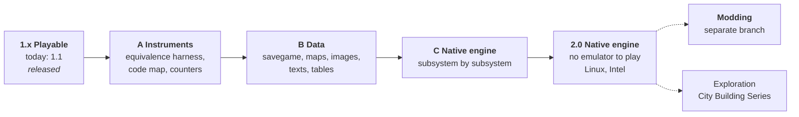

# Roadmap

**The aim: keep *Zeus* and *Poseidon* playable for as long as people want to play them — the
original game, unmodified in behaviour, on the machines people actually own, and proven identical
to the original.**

The game is playable today (version 1.1, Apple Silicon Macs). What follows replaces the original
code **piece by piece with an engine written by hand and documented**. The emulated original stays
the reference and the judge: every rewritten part must prove, turn by turn, that it leaves the
game in exactly the same state. No code is translated mechanically. The precedent is
[Julius](https://github.com/bvschaik/julius), the same work done for *Caesar III*.

No dates are promised: each step is done when it is proven, not before.

| Step | Theme | State | Follow it |
|---|---|---|---|
| **1.x — Playable** | The game as it is: lighter on the machine, every language edition, a simpler first launch | released (1.1); ongoing | [milestone](https://github.com/nic0lasm/zeus-poseidon-arm64/milestone/2) · [#22](https://github.com/nic0lasm/zeus-poseidon-arm64/issues/22) · [#24](https://github.com/nic0lasm/zeus-poseidon-arm64/issues/24) · [#55](https://github.com/nic0lasm/zeus-poseidon-arm64/issues/55) |
| **Phase A — Instruments** | Equivalence harness on the full game state; code map; two public counters (functions understood out of 4,872, share of the computation done natively) | next | [milestone](https://github.com/nic0lasm/zeus-poseidon-arm64/milestone/7) · [#26](https://github.com/nic0lasm/zeus-poseidon-arm64/issues/26) · [#69](https://github.com/nic0lasm/zeus-poseidon-arm64/issues/69) |
| **Phase B — Data** | Savegame `.sav` described in full, then maps and adventures, images, texts, tables; each format read then written back byte for byte | planned | [milestone](https://github.com/nic0lasm/zeus-poseidon-arm64/milestone/8) · [#70](https://github.com/nic0lasm/zeus-poseidon-arm64/issues/70) · [#30](https://github.com/nic0lasm/zeus-poseidon-arm64/issues/30) |
| **Phase C — Native engine** | Rendering, interface and texts, terrain, movement and walkers, housing and buildings, economy, gods, heroes and monsters, army, events and adventures, savegame | planned | [milestone](https://github.com/nic0lasm/zeus-poseidon-arm64/milestone/9) · [#71](https://github.com/nic0lasm/zeus-poseidon-arm64/issues/71) |
| **2.0 — Native engine** | No emulator to play; Linux and Intel follow from it | after the engine | [milestone](https://github.com/nic0lasm/zeus-poseidon-arm64/milestone/3) · [#25](https://github.com/nic0lasm/zeus-poseidon-arm64/issues/25) · [#38](https://github.com/nic0lasm/zeus-poseidon-arm64/issues/38) · [#39](https://github.com/nic0lasm/zeus-poseidon-arm64/issues/39) · [#40](https://github.com/nic0lasm/zeus-poseidon-arm64/issues/40) · [#41](https://github.com/nic0lasm/zeus-poseidon-arm64/issues/41) |
| **Modding (branch)** | Changes to the game, on a `modding` branch | later | [milestone](https://github.com/nic0lasm/zeus-poseidon-arm64/milestone/10) · [#72](https://github.com/nic0lasm/zeus-poseidon-arm64/issues/72) |
| exploration | The City Building Series: *Emperor*, *Pharaoh*, *Caesar III* | on hold | [milestone](https://github.com/nic0lasm/zeus-poseidon-arm64/milestone/5) · [#28](https://github.com/nic0lasm/zeus-poseidon-arm64/issues/28) · [#29](https://github.com/nic0lasm/zeus-poseidon-arm64/issues/29) |

## What does not change

These rules hold for every step; they are what makes the project trustworthy.

- **The original is the reference.** It keeps running, emulated, as the judge: a rewritten part
  is accepted only when it gives exactly the same game state, turn by turn, on replayable
  scenarios and on real saves.
- **Written by hand, documented.** No mechanically translated code. Each subsystem gets a page
  in `docs/engine/`, the native code and its proof of equivalence.
- **Nothing from the game is distributed.** The repository and the releases contain only this
  project's code. Whatever is derived from the game — language packs, data read from the
  player's own files — is produced on the player's machine, from the player's own copy.
- **`main` stays the original game.** Only what changes nothing in the original game enters
  `main`; modding comes later, on a branch.
- **No copy protection is touched.** Only the DRM-free GOG edition is run.

## 1.x — Playable

The game works. This line keeps it comfortable: first launch in few clicks ([#55](https://github.com/nic0lasm/zeus-poseidon-arm64/issues/55)), language packs
for every edition ([#24](https://github.com/nic0lasm/zeus-poseidon-arm64/issues/24), testers needed), and less processor use ([#22](https://github.com/nic0lasm/zeus-poseidon-arm64/issues/22)), which becomes a side
effect of Phase C rather than a goal of its own.

## Phase A — Instruments

Before rewriting anything, the means to prove it.

- **Equivalence harness** ([#26](https://github.com/nic0lasm/zeus-poseidon-arm64/issues/26), done): the whole game state compared tick by tick between the
  pure original and the host, and one game function run original and native from the same
  state with registers and memory compared ([equivalence.md](equivalence.md)).
- **Code map and counters** ([#69](https://github.com/nic0lasm/zeus-poseidon-arm64/issues/69)): each of the 4,872 functions of the GOG executable filed under a module, and two
  public numbers — functions understood out of 4,872, and the share of the computation done
  natively.

## Phase B — Data

The game's files, described completely and rewritten byte for byte.

- **Savegame** ([#70](https://github.com/nic0lasm/zeus-poseidon-arm64/issues/70)): the `.sav` file described in full, with a reader and a writer.
- **Then** maps and adventures, images, texts and tables ([#30](https://github.com/nic0lasm/zeus-poseidon-arm64/issues/30)); sprites, maps and texts are
  already partly done.

**Done when** each format read and then written back gives the identical file.

## Phase C — Native engine by subsystem

One parent issue ([#71](https://github.com/nic0lasm/zeus-poseidon-arm64/issues/71)) lists the subsystems: rendering, interface and texts, terrain, movement
and walkers, housing and buildings, economy, gods, heroes and monsters, army, events and
adventures, savegame. For each: a page in `docs/engine/`, the native code, and the proof of
equivalence against the emulated original. Lower processor use ([#22](https://github.com/nic0lasm/zeus-poseidon-arm64/issues/22)) comes along.

## 2.0 — Native engine

**No emulator to play.** Once the engine is complete, the game runs on its own with the player's
own data files. Linux and Intel Macs follow from it ([#25](https://github.com/nic0lasm/zeus-poseidon-arm64/issues/25)); the portable pieces already
started — MP3 decoding is done ([#37](https://github.com/nic0lasm/zeus-poseidon-arm64/issues/37)) — are [#38](https://github.com/nic0lasm/zeus-poseidon-arm64/issues/38) JPEG, [#39](https://github.com/nic0lasm/zeus-poseidon-arm64/issues/39) dialogs, [#40](https://github.com/nic0lasm/zeus-poseidon-arm64/issues/40) Linux build,
[#41](https://github.com/nic0lasm/zeus-poseidon-arm64/issues/41) universal Mac application.

## Modding (branch)

Later, on a `modding` branch ([#72](https://github.com/nic0lasm/zeus-poseidon-arm64/issues/72)). Nothing that changes the original game enters `main`.

## Exploration — the City Building Series

*Emperor: Rise of the Middle Kingdom* was built on the engine of *Zeus*; *Pharaoh* and *Caesar III*
come from the generation before. On hold: measurements first, a milestone only if the answer is
good ([#28](https://github.com/nic0lasm/zeus-poseidon-arm64/issues/28), [#29](https://github.com/nic0lasm/zeus-poseidon-arm64/issues/29)).

## Ongoing — the game's knowledge, written down

Every file format documented with a reference reader ([#30](https://github.com/nic0lasm/zeus-poseidon-arm64/issues/30)). This knowledge outlives any port
and serves modders and tool makers.

## Decisions for the maintainer

- **A signed and notarised application** would remove the *Open Anyway* steps on first
  launch. It needs a paid Apple Developer membership; under consideration.

---

## Looking back on 1.0

**What worked.**

- *Running the original code instead of rewriting it.* An earlier plan rewrote the engine module
  by module; switching to an emulator with a native Windows layer turned an open-ended rewrite
  into a playable game in a few milestones, with fidelity for free.
- *Letting the game say what it needs.* A Windows function that is not written stops the program
  and names itself: 199 of the 202 imports were written that way, in the order the game asked
  for them. The last three are never reached
  ([details](reverse-engineering.md#findings-in-the-gog-executable)).
- *Proving every change.* The deterministic scenarios turned "it seems to work" into "these
  38,593 frames are identical", which made bold optimisations safe.

**What we learned.**

- *Measure before optimising, and check the measure.* An early profiler overstated short loops;
  the first native functions brought nothing; the 3.5-second start-up turned out to be one loop
  of 18 million string comparisons; and the clock calls that looked like a busy wait were the
  game's own profiling timers.
- *Deterministic tests do not see time.* The scenarios run on a virtual clock, so they could not
  notice that the host's pacing slowed the game down to two thirds of its speed from 0.2 to 1.0.
  Real-time measurements of ticks per second now complement them.
- *Emulator overhead hides in unexpected places.* Without paging, every memory write took the
  emulator's slow path; mapping data as non-executable gave a fourfold speed-up.
- *Releases need the same care as code.* Two early archives carried build paths of the machine
  that made them; packaging now strips and checks every byte.

**Risks we keep an eye on.**

- One Mac model and two language editions tested so far: reports from other setups matter more
  than any new feature.
- The project depends on Unicorn; its x86 emulation and its performance are outside our hands
  until 3.0.

## History

| # | Milestone | Visible result | State |
|---|---|---|---|
| 0 | Scoping | DRM-free GOG executable identified and analysed | done |
| 1 | The game starts | the real main menu in a Mac window | done |
| 2 | Playable | mouse, keyboard, load and save, a tutorial can be played | done |
| 3 | Complete | music, sound effects, intro video, full screen | done |
| 4 | Ready to share | performance, self-contained `.app`, automated builds, first release | done (0.1) |
| 5 | French edition | French texts and voices from the player's own CDs, wide screens | done (0.2, 0.3) |
| 6 | Native code | drawing, start-up and the sprite dispatcher in native code | partly done since 0.4; continues as 3.0 |

### Releases

| Version | Highlights |
|---|---|
| [1.1](https://github.com/nic0lasm/zeus-poseidon-arm64/releases/tag/v1.1) | easier first launch; taller wide modes; native ground drawing; Linux build in CI |
| [1.0.1](https://github.com/nic0lasm/zeus-poseidon-arm64/releases/tag/v1.0.1) | the game at its real speed; native sprite dispatcher; this roadmap |
| [1.0](https://github.com/nic0lasm/zeus-poseidon-arm64/releases/tag/v1.0) | first stable version: the code of 0.9, played through by hand |
| [0.9](https://github.com/nic0lasm/zeus-poseidon-arm64/releases/tag/v0.9) | release candidate: start-up under a second, real resolution shown in wide mode, file cache limited to small files |
| [0.4](https://github.com/nic0lasm/zeus-poseidon-arm64/releases/tag/v0.4) | 3D sound; six native routines and 100 ns system calls; mouse wheel; pause in the background; scenarios for Poseidon, the editor, the options and a large city |
| [0.3](https://github.com/nic0lasm/zeus-poseidon-arm64/releases/tag/v0.3) | wide screen; language packs built by the application from CD images; stripped and checked bundle |
| [0.2](https://github.com/nic0lasm/zeus-poseidon-arm64/releases/tag/v0.2) | French; non-executable data pages and a paced loop (half the CPU); stop report; GOG installer opened by the application; LGPL FFmpeg |
| [0.1](https://github.com/nic0lasm/zeus-poseidon-arm64/releases/tag/v0.1) | first preview: the original game in a sandboxed emulator, menus, tutorials, building, save and load, music, sound, intro video, full screen, application bundle |

The archives of 0.1 and 0.2 were withdrawn: they carried build paths of the machine that made
them. Every release and pull request is listed in [CHANGELOG.md](../CHANGELOG.md).

### What 1.0 was checked against

- By hand: adventures of Zeus and Poseidon, 3D sound by ear, the pause when switching to
  another application with ⌘Tab, the mouse wheel, a French pack built by the application from
  the original CDs, in window and full screen, on a MacBook Air M4.
- Eight replayable scenarios (`tests/scenarios`): first tutorial, first Zeus adventure with
  every tab of the control panel, first Poseidon adventure, the adventure editor, every window
  of the *Options* menu and the in-game help, wide mode, background pause and mouse wheel, the
  large city of the last tutorial. Identical with and without the native functions.
- Each of the sixteen tutorials loaded in turn and its screen reviewed.
- Endurance: the large city at full game speed for 25 minutes (several game years, autosaves,
  an earthquake, a god and a monster in the streets); 20 minutes with memory sampled every
  minute (flat, about 530 MB); 10 minutes with the released application, a French pack and
  wide mode.
- Every sound file of the game (703 WAV, 929 MP3, 311 minutes) decodes through the code paths
  of the mixer (`zeus-run --check-audio`); so do the files of a French pack.
- Save and load in a Poseidon adventure with the French pack, under an accented name; the file
  is read to the last byte by `tools/mapfile.py`.

### Known limits

- Sound: the fall-off of 3D ambience with distance is an assumption (linear, between Miles's
  default distances).
- Video: audio and picture are paced independently, so they may drift slightly.
- The game's *Windowed screen* option is refused by the game itself (it compares the screen
  with the mode, and the host reports a screen the size of the mode); ⌘F switches between
  window and full screen instead.
- The world map image is 838×738: in a wide mode, wider or taller than 1024×768, the city stays
  visible to its right and below it ([#23](https://github.com/nic0lasm/zeus-poseidon-arm64/issues/23)).

### Native code: how it works

**A rule first.** Code translated mechanically from the game's executable is still the game's
code: it cannot be kept in this repository or shipped in a release. Native code here is
written by hand from an understanding of what a function does, and proven against the original
with the frame logs of deterministic runs. Mechanical translation (Ghidra p-code,
`tools/ghidra/ExportPcode.java`) is only a reading aid. Version 3.0 keeps the rule by running
its translator on the player's machine.

**How a native function is entered.** The first byte of the game's function is replaced in
memory by a plain return, and the host function runs just before it, from a hook. The emulator
is never diverted, so entering costs about 75 ns. System calls use the same trick: each import
slot holds a `ret n`, which brought a system call from 4,500 ns down to about 100 ns.
`zeus-run --bench` measures both. For scale, copying one 58×30 tile takes 4,700 ns emulated and
130 ns natively. A loop can be replaced on its own (its first instruction becomes a jump to its
exit), and a function can get a native fast path that falls back to the original code
(`Cpu::add_fast_path`).

**Where the time goes.** `zeus-run --profile` measures time per block of game code and
`tools/profile_report.py` sums it per function, subtracting the cost of the measurement itself.

**What is native today** (`src/win32/native.cpp` and `native_draw.cpp`, on by default, `--no-native` to compare):

| Game function | What it does |
|---|---|
| `0x00413DC0` | copies an opaque rectangle to the frame buffer |
| `0x00416010` | same, with magenta as the transparent colour |
| `0x004161B0` | draws a run-length compressed image, optionally as a shadow |
| `0x004163B0`, `0x004165D0` | the same, clipped on the left or on the right |
| `0x00413E30` | draws a run-length compressed image blended with the background |
| `0x0050B410` | clears the frame buffer |
| `0x005CC640` | `_strcmpi` from the C runtime |
| `0x005059F8` | the loop that looks up each key of `Model\Zeus eventmsg.txt` at start-up (18 million `_strcmpi` calls): start-up went from 3.5–5 s to under a second |
| `0x005ACF50` | the sprite dispatcher, for its common cases (run-length images not mirrored, clipped or not; opaque images and ground tiles not clipped sideways), with its clipping (`0x00509C20`, `0x00509CD0`); every other case falls back to the original |
| `0x005ADF00` | the top of a building, the compressed part above its base, placed by the width of the base; with an overlay colour it falls back to the original |
| `0x00435070` | draws a ground tile, a 58 × 30 diamond (`src/win32/native_draw.cpp`) |
| `0x00457900` | the ground of one city tile, for its common cases: flat or sloped land in the normal view, animated water included |
| `0x00458170` | the city drawing loop: its first pass over the visible tiles (the ground), and its second pass (what stands on each tile) for 81 % of the cells of a large city, through host jumps that hand back to the original, mid-cell if needed, for any other case |

All nine scenarios (43,159 frames, 13,073 simulation ticks) give the same frames and the same game state, tick by tick, with and without them, and each of them passes the call-by-call check of [equivalence.md](equivalence.md).

**Also on the host side.** The game reopens the same small files thousands of times a minute;
read-only files of 4 MB or less are kept in memory and directory listings are cached.

### Wide screens

`zeus-run --wide auto` (always on in the application) replaces the game's 1024×768 mode by a
wider one that matches the proportions of the screen, for instance 1204×768 on a 16:10 display
and 1324×768 on a 16:9 one. Choose the largest resolution in *Options → Display options*: the
map view grows, the control panel stays at the right edge. Menus and briefing screens are drawn
by the game in 800×600 whatever the mode. The labels of the display options and of the F7 key
show the real size: the host serves the game a copy of its text files where "1024 x 768" is
replaced, at equal length. How it works is described in
[reverse-engineering.md](reverse-engineering.md).

### Earlier work

Before the current approach, the project decoded the sprite and map formats and ported the
terrain renderer natively (`zeus-sprites`, `zeus-map`). That code is kept as a reference. One
known defect remains in the native terrain renderer (black diamonds at the foot of some cliffs).
