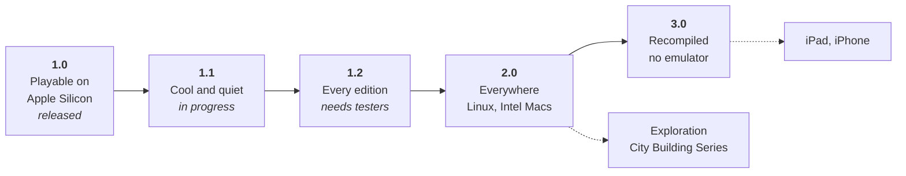

# Roadmap

**The aim: keep *Zeus* and *Poseidon* playable for as long as people want to play them — the
original game, unmodified, on the machines people actually own, and proven identical to the
original.**

Version 1.0 reached the first part on Apple Silicon Macs. What follows takes the same game
further: lighter on the machine, in every language edition, on more systems, and finally without
an emulator at all.

| Version | Theme | State | Follow it |
|---|---|---|---|
| **1.0.1** | The whole game on Apple Silicon Macs, at its real speed | released | [release notes](https://github.com/nic0lasm/zeus-poseidon-arm64/releases/tag/v1.0.1) |
| **1.1** | Cool and quiet: as little CPU as the game needs | in progress | [milestone](https://github.com/nic0lasm/zeus-poseidon-arm64/milestone/1) · [#21](https://github.com/nic0lasm/zeus-poseidon-arm64/pull/21), [#32](https://github.com/nic0lasm/zeus-poseidon-arm64/pull/32) done · [#22](https://github.com/nic0lasm/zeus-poseidon-arm64/issues/22) · [#23](https://github.com/nic0lasm/zeus-poseidon-arm64/issues/23) |
| **1.2** | Every language edition | needs testers | [milestone](https://github.com/nic0lasm/zeus-poseidon-arm64/milestone/2) · [#24](https://github.com/nic0lasm/zeus-poseidon-arm64/issues/24) |
| **2.0** | Everywhere: Linux (x86-64, arm64) and Intel Macs | planned | [milestone](https://github.com/nic0lasm/zeus-poseidon-arm64/milestone/3) · [#25](https://github.com/nic0lasm/zeus-poseidon-arm64/issues/25) |
| **3.0** | Recompiled: no emulator, the player's own copy translated to native code | research | [milestone](https://github.com/nic0lasm/zeus-poseidon-arm64/milestone/4) · [#26](https://github.com/nic0lasm/zeus-poseidon-arm64/issues/26) · [#27](https://github.com/nic0lasm/zeus-poseidon-arm64/issues/27) |
| exploration | The City Building Series: *Emperor*, *Pharaoh*, *Caesar III* | research | [milestone](https://github.com/nic0lasm/zeus-poseidon-arm64/milestone/5) · [#28](https://github.com/nic0lasm/zeus-poseidon-arm64/issues/28) · [#29](https://github.com/nic0lasm/zeus-poseidon-arm64/issues/29) |
| ongoing | Every file format of the game documented | open to all | [#30](https://github.com/nic0lasm/zeus-poseidon-arm64/issues/30) |

## What does not change

These rules hold for every version below; they are what makes the project trustworthy.

- **The original code runs, unmodified.** Fidelity comes from the game itself, not from a
  reimplementation: same simulation, same rules, same save files.
- **Nothing from the game is distributed.** The repository and the releases contain only this
  project's code. Whatever is derived from the game — language packs today, recompiled code
  tomorrow — is produced on the player's machine, from the player's own copy.
- **Every change is proven.** Eight replayable scenarios compare every frame with a reference;
  a change that alters a single pixel of the game fails. A statement about the game cites its
  evidence (address, offset, measurement).
- **No copy protection is touched.** Only the DRM-free GOG edition is run.

## 1.1 — Cool and quiet

**Why.** The game is fast enough, but it still keeps one CPU core busy, which costs battery and
fan noise on a laptop.

- **Native sprite dispatcher** — done ([#21](https://github.com/nic0lasm/zeus-poseidon-arm64/pull/21)):
  42 % less computing time in a large city.
- **The right game speed, with fewer loop turns** — done
  ([#32](https://github.com/nic0lasm/zeus-poseidon-arm64/pull/32)). Looking for a busy wait showed
  something else: the game ticks only when a loop turn finds its interval elapsed, and the host's
  fixed 16 ms pacing stretched the 22 ms interval of the default speed to 33 ms. The game had been
  running at two thirds of its speed; it now ticks 45 times a second as intended, on 42 % of a
  core instead of 52 %.
- **Less work per turn** ([#22](https://github.com/nic0lasm/zeus-poseidon-arm64/issues/22)). The
  clock calls turned out to be the game's own profiling timers around each walker, not a wait:
  what keeps the core busy is the simulation and the drawing of every turn, still emulated. In
  the order of the profile:
  - [ ] the city drawing loop `0x00458170` ([#34](https://github.com/nic0lasm/zeus-poseidon-arm64/issues/34));
  - [ ] the control panel text routines, about 8 % of the time ([#35](https://github.com/nic0lasm/zeus-poseidon-arm64/issues/35));
  - [ ] research: the game redraws every turn but shows a frame at most every 50 ms — can the
    unseen drawings be skipped without changing what the game computes?
    ([#36](https://github.com/nic0lasm/zeus-poseidon-arm64/issues/36))
- **Taller wide modes** ([#23](https://github.com/nic0lasm/zeus-poseidon-arm64/issues/23)), so that
  a 16:10 screen shows more of the city instead of scaling up 768 lines.

**Done when** a small city uses less than 20 % of one core and the large city of the last
tutorial less than 35 %, with the same frame rate and the same frames.

## 1.2 — Every edition

**Why.** The game was sold in a dozen languages. French works because the application can build
a pack from the original CDs; every other edition should work the same way.

- Packs for German, Spanish, Italian, Polish, Dutch, Swedish, Czech… tested by the people who
  own those CDs ([#24](https://github.com/nic0lasm/zeus-poseidon-arm64/issues/24)).
- `docs/languages.md` lists each edition reported on, and what it needed.

## 2.0 — Everywhere

**Why.** Nothing in the approach is specific to the Mac. A player on Linux, on an Intel Mac or on
an ARM single-board computer deserves the same game without Wine or a virtual machine.

The host is about 7,000 lines of C++ on SDL2, Unicorn and FFmpeg, all portable. Four pieces tie
it to macOS — MP3 and JPEG decoding, the dialogs, the application bundle — and each has a
portable replacement ([#25](https://github.com/nic0lasm/zeus-poseidon-arm64/issues/25)):

- [x] MP3 decoding without AudioToolbox; done when `--check-audio` passes the 929 MP3 files with
  the same durations ([#37](https://github.com/nic0lasm/zeus-poseidon-arm64/issues/37));
- [ ] JPEG decoding without ImageIO, same pixels ([#38](https://github.com/nic0lasm/zeus-poseidon-arm64/issues/38));
- [ ] first-launch dialogs, Option key and screen size through SDL ([#39](https://github.com/nic0lasm/zeus-poseidon-arm64/issues/39));
- [ ] Linux x86-64 and arm64 in the automated build, then an AppImage ([#40](https://github.com/nic0lasm/zeus-poseidon-arm64/issues/40));
- [ ] one universal Mac application, Intel and Apple Silicon ([#41](https://github.com/nic0lasm/zeus-poseidon-arm64/issues/41)).

**Done when** the tutorial scenario gives the same frame log on Linux x86-64, Linux arm64 and
macOS, and downloadable builds exist for each (AppImage, universal Mac application).

## 3.0 — Recompiled

**Why.** An emulator is the safest way to run the original code, but not the lightest, and
iPads and iPhones forbid the just-in-time translation it relies on. The ambition of this version
is to **remove the emulator** while keeping both founding rules:

- the translation of `Zeus.exe` to native code happens **on the player's machine**, from the
  player's own copy, like a language pack — the repository ships the recompiler, never its
  output;
- the emulator stays as the **reference**: every recompiled function must leave the game in
  exactly the state the emulated one would.

The path ([#27](https://github.com/nic0lasm/zeus-poseidon-arm64/issues/27)):

1. **An equivalence harness** ([#26](https://github.com/nic0lasm/zeus-poseidon-arm64/issues/26)):
   run one game function emulated and native from the same state, compare everything. Useful
   right away for hand-written native code.
2. **A translator**, x86-32 to C, one function at a time: exact flags, x87 floating point, the
   game's jump tables. The list of 8,397 functions already comes from Ghidra. It starts small,
   on the two clipping routines already rewritten by hand, which give a reference
   ([#42](https://github.com/nic0lasm/zeus-poseidon-arm64/issues/42)).
3. **Mixed mode**: recompiled functions enter through the mechanism the sprite dispatcher uses
   today (`Cpu::add_fast_path`), with the emulator as fall-back; coverage grows function by
   function, measured by the scenarios.
4. **No emulator**, then an **iPad edition** with touch controls as a separate exploration.

## Exploration — the City Building Series

*Emperor: Rise of the Middle Kingdom* was built on the engine of *Zeus*, and is likely to need
much the same Windows libraries; *Pharaoh* and *Caesar III* come from the generation before.
Could the same host bring them back too? Measurements first — imports compared, a first boot —
and a milestone only if the answer is good
([#28](https://github.com/nic0lasm/zeus-poseidon-arm64/issues/28),
[#29](https://github.com/nic0lasm/zeus-poseidon-arm64/issues/29)).

## Ongoing — the game's knowledge, written down

Every file format documented with a reference reader that reads all the files of its type
([#30](https://github.com/nic0lasm/zeus-poseidon-arm64/issues/30)): sprites, maps and texts are done;
simulation parameters and adventures remain. This knowledge outlives any port and serves
modders and tool makers.

## Decisions for the maintainer

- **A signed and notarised application** would remove the right-click → *Open* step on first
  launch. It needs a paid Apple Developer membership; under consideration.

---

## Looking back on 1.0

**What worked.**

- *Running the original code instead of rewriting it.* An earlier plan rewrote the engine module
  by module; switching to an emulator with a native Windows layer turned an open-ended rewrite
  into a playable game in a few milestones, with fidelity for free.
- *Letting the game say what it needs.* A Windows function that is not written stops the program
  and names itself: 199 of the 202 imports were written that way, in the order the game asked
  for them. The last three are never reached
  ([details](reverse-engineering.md#findings-in-the-gog-executable)).
- *Proving every change.* The deterministic scenarios turned "it seems to work" into "these
  38,593 frames are identical", which made bold optimisations safe.

**What we learned.**

- *Measure before optimising, and check the measure.* An early profiler overstated short loops;
  the first native functions brought nothing; the 3.5-second start-up turned out to be one loop
  of 18 million string comparisons; and the clock calls that looked like a busy wait were the
  game's own profiling timers.
- *Deterministic tests do not see time.* The scenarios run on a virtual clock, so they could not
  notice that the host's pacing slowed the game down to two thirds of its speed from 0.2 to 1.0.
  Real-time measurements of ticks per second now complement them.
- *Emulator overhead hides in unexpected places.* Without paging, every memory write took the
  emulator's slow path; mapping data as non-executable gave a fourfold speed-up.
- *Releases need the same care as code.* Two early archives carried build paths of the machine
  that made them; packaging now strips and checks every byte.

**Risks we keep an eye on.**

- One Mac model and two language editions tested so far: reports from other setups matter more
  than any new feature.
- The project depends on Unicorn; its x86 emulation and its performance are outside our hands
  until 3.0.

## History

| # | Milestone | Visible result | State |
|---|---|---|---|
| 0 | Scoping | DRM-free GOG executable identified and analysed | done |
| 1 | The game starts | the real main menu in a Mac window | done |
| 2 | Playable | mouse, keyboard, load and save, a tutorial can be played | done |
| 3 | Complete | music, sound effects, intro video, full screen | done |
| 4 | Ready to share | performance, self-contained `.app`, automated builds, first release | done (0.1) |
| 5 | French edition | French texts and voices from the player's own CDs, wide screens | done (0.2, 0.3) |
| 6 | Native code | drawing, start-up and the sprite dispatcher in native code | partly done since 0.4; continues as 3.0 |

### Releases

| Version | Highlights |
|---|---|
| [1.0.1](https://github.com/nic0lasm/zeus-poseidon-arm64/releases/tag/v1.0.1) | the game at its real speed; native sprite dispatcher; this roadmap |
| [1.0](https://github.com/nic0lasm/zeus-poseidon-arm64/releases/tag/v1.0) | first stable version: the code of 0.9, played through by hand |
| [0.9](https://github.com/nic0lasm/zeus-poseidon-arm64/releases/tag/v0.9) | release candidate: start-up under a second, real resolution shown in wide mode, file cache limited to small files |
| [0.4](https://github.com/nic0lasm/zeus-poseidon-arm64/releases/tag/v0.4) | 3D sound; six native routines and 100 ns system calls; mouse wheel; pause in the background; scenarios for Poseidon, the editor, the options and a large city |
| [0.3](https://github.com/nic0lasm/zeus-poseidon-arm64/releases/tag/v0.3) | wide screen; language packs built by the application from CD images; stripped and checked bundle |
| [0.2](https://github.com/nic0lasm/zeus-poseidon-arm64/releases/tag/v0.2) | French; non-executable data pages and a paced loop (half the CPU); stop report; GOG installer opened by the application; LGPL FFmpeg |
| [0.1](https://github.com/nic0lasm/zeus-poseidon-arm64/releases/tag/v0.1) | first preview: the original game in a sandboxed emulator, menus, tutorials, building, save and load, music, sound, intro video, full screen, application bundle |

The archives of 0.1 and 0.2 were withdrawn: they carried build paths of the machine that made
them. Every release and pull request is listed in [CHANGELOG.md](../CHANGELOG.md).

### What 1.0 was checked against

- By hand: adventures of Zeus and Poseidon, 3D sound by ear, the pause when switching to
  another application with ⌘Tab, the mouse wheel, a French pack built by the application from
  the original CDs, in window and full screen, on a MacBook Air M4.
- Eight replayable scenarios (`tests/scenarios`): first tutorial, first Zeus adventure with
  every tab of the control panel, first Poseidon adventure, the adventure editor, every window
  of the *Options* menu and the in-game help, wide mode, background pause and mouse wheel, the
  large city of the last tutorial. Identical with and without the native functions.
- Each of the sixteen tutorials loaded in turn and its screen reviewed.
- Endurance: the large city at full game speed for 25 minutes (several game years, autosaves,
  an earthquake, a god and a monster in the streets); 20 minutes with memory sampled every
  minute (flat, about 530 MB); 10 minutes with the released application, a French pack and
  wide mode.
- Every sound file of the game (703 WAV, 929 MP3, 311 minutes) decodes through the code paths
  of the mixer (`zeus-run --check-audio`); so do the files of a French pack.
- Save and load in a Poseidon adventure with the French pack, under an accented name; the file
  is read to the last byte by `tools/mapfile.py`.

### Known limits

- Sound: the fall-off of 3D ambience with distance is an assumption (linear, between Miles's
  default distances).
- Video: audio and picture are paced independently, so they may drift slightly.
- The game's *Windowed screen* option is refused by the game itself (it compares the screen
  with the mode, and the host reports a screen the size of the mode); ⌘F switches between
  window and full screen instead.
- The control panel artwork is 768 pixels high: a taller wide mode (`--wide 1444x903`) works
  but leaves a black band under the panel, which is why `auto` keeps the height at 768
  ([#23](https://github.com/nic0lasm/zeus-poseidon-arm64/issues/23)).

### Native code: how it works

**A rule first.** Code translated mechanically from the game's executable is still the game's
code: it cannot be kept in this repository or shipped in a release. Native code here is
written by hand from an understanding of what a function does, and proven against the original
with the frame logs of deterministic runs. Mechanical translation (Ghidra p-code,
`tools/ghidra/ExportPcode.java`) is only a reading aid. Version 3.0 keeps the rule by running
its translator on the player's machine.

**How a native function is entered.** The first byte of the game's function is replaced in
memory by a plain return, and the host function runs just before it, from a hook. The emulator
is never diverted, so entering costs about 75 ns. System calls use the same trick: each import
slot holds a `ret n`, which brought a system call from 4,500 ns down to about 100 ns.
`zeus-run --bench` measures both. For scale, copying one 58×30 tile takes 4,700 ns emulated and
130 ns natively. A loop can be replaced on its own (its first instruction becomes a jump to its
exit), and a function can get a native fast path that falls back to the original code
(`Cpu::add_fast_path`).

**Where the time goes.** `zeus-run --profile` measures time per block of game code and
`tools/profile_report.py` sums it per function, subtracting the cost of the measurement itself.

**What is native today** (`src/win32/native.cpp`, on by default, `--no-native` to compare):

| Game function | What it does |
|---|---|
| `0x00413DC0` | copies an opaque rectangle to the frame buffer |
| `0x00416010` | same, with magenta as the transparent colour |
| `0x004161B0` | draws a run-length compressed image, optionally as a shadow |
| `0x00413E30` | draws a run-length compressed image blended with the background |
| `0x0050B410` | clears the frame buffer |
| `0x005CC640` | `_strcmpi` from the C runtime |
| `0x005059F8` | the loop that looks up each key of `Model\Zeus eventmsg.txt` at start-up (18 million `_strcmpi` calls): start-up went from 3.5–5 s to under a second |
| `0x005ACF50` | the sprite dispatcher, for its two common cases (run-length and opaque images, neither clipped sideways nor mirrored, 95 % of the calls), with its clipping (`0x00509C20`, `0x00509CD0`); every other case falls back to the original |

All eight scenarios (38,593 frames) give the same frame logs with and without them.

**Also on the host side.** The game reopens the same small files thousands of times a minute;
read-only files of 4 MB or less are kept in memory and directory listings are cached.

### Wide screens

`zeus-run --wide auto` (always on in the application) replaces the game's 1024×768 mode by a
wider one that matches the proportions of the screen, for instance 1204×768 on a 16:10 display
and 1324×768 on a 16:9 one. Choose the largest resolution in *Options → Display options*: the
map view grows, the control panel stays at the right edge. Menus and briefing screens are drawn
by the game in 800×600 whatever the mode. The labels of the display options and of the F7 key
show the real size: the host serves the game a copy of its text files where "1024 x 768" is
replaced, at equal length. How it works is described in
[reverse-engineering.md](reverse-engineering.md).

### Earlier work

Before the current approach, the project decoded the sprite and map formats and ported the
terrain renderer natively (`zeus-sprites`, `zeus-map`). That code is kept as a reference. One
known defect remains in the native terrain renderer (black diamonds at the foot of some cliffs).
